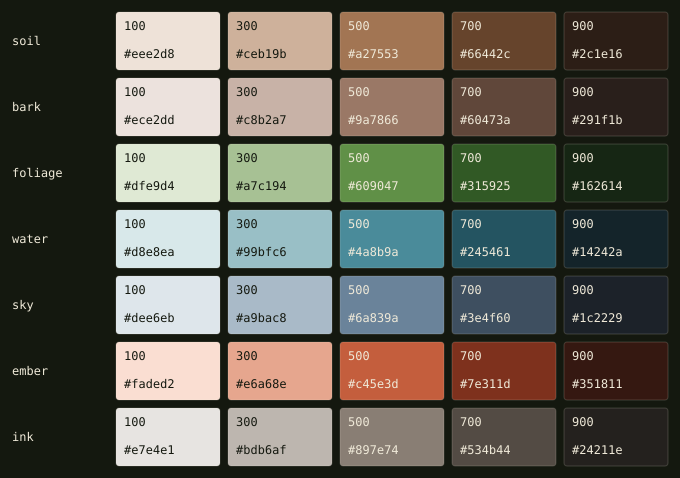

# Art bible

**Status:** in use (T00). Owned by the C-series rendering tasks; updated at every gate. The pillars, the organism anatomy, the mutation-signature rules and the water rules are populated; audio direction (C06) and the sky/weather palette notes (C03) are still open.
**Source of truth:** DESIGN.md Part 19. This file exists so every AI session shares
one visual language; it is not a second spec.

## Pillars

1. Light is the hero — warm direct light, cool shade, visible canopy shadows.
2. Readable silhouettes — detail lives in gradients and shader noise.
3. Painterly materials, believable forms — no photographic high-frequency texture.
4. Quiet interface — the HUD disappears into the world's palette.

## Direction

Stylized naturalism (D-18). PBR-lite, one directional light, hemispheric ambient,
rim light on plants, aerial-perspective fog.

**What is built, and what is still direction (verified 2026-11-16):**

- *Built:* the shared atmosphere model (`renderers/environment/atmosphere.ts`,
  one air for ground, plants and the sky), the underwater medium
  (`underwater.ts`, §Water below), sky dome and celestial arcs, weather tinting.
- *Direction only:* **per-time-of-day colour grading** and any bloom or exposure
  work. The client renders with no tone mapping and no post chain — the vignette
  and grain are a DOM overlay — so bright and emissive values clip rather than
  grade. The ranking for fixing that is Wave 3-D in
  [`improvement-plan.md`](./improvement-plan.md); the reasoning is §12.2 of
  [`abyssal-garden-source-analysis.md`](./abyssal-garden-source-analysis.md).
- *Direction only:* cascaded or contact shadows. There is one shadow map,
  refreshed on a timer.

## Palette

The colour source of truth for A01 is `config/palette.json`: seven ramps authored
in OKLCH (lightness, chroma, hue) on one lightness ladder, plus a `roles` map that
names the step each surface should ask for. Nothing quotes a hex directly - the
swatches below, and every hex in them, are generated from that file by
`tools/palette`.

Why OKLCH: a step means the same value in every material, so the ground, a stem
and the HUD cannot drift apart a shade at a time; and the hue can drift along the
ramp without breaking it - warm at the light end, cool in shadow, which is pillar
1 (light is the hero) written in data instead of in taste. The second table is
the one to build against: a surface asks for a role, never for a step.

`pnpm palette:write` regenerates this section and `docs/assets/palette.svg`;
`pnpm verify` fails when either is stale, and `node tools/palette/build.mjs`
rejects a step outside sRGB rather than documenting a clipped hex.

<!-- palette:start -->
### Ramps

One lightness ladder (0.92 / 0.78 / 0.60 / 0.42 / 0.25) across every material:
step 100 is the lightest, 900 the darkest, and the hue drifts toward the warm
end at the top of the ramp and the cool end in shadow. The hexes are derived,
never authored.

| Ramp | Use | 100 | 300 | 500 | 700 | 900 |
|---|---|---|---|---|---|---|
| `soil` | ground, cut faces, the pit wall and every dust the world kicks up | `#eee2d8` | `#ceb19b` | `#a27553` | `#66442c` | `#2c1e16` |
| `bark` | stems, branches and the woody rim of a junction | `#ece2dd` | `#c8b2a7` | `#9a7866` | `#60473a` | `#291f1b` |
| `foliage` | blades, sprouts, the lit side of a canopy and the plant's own glow | `#dfe9d4` | `#a7c194` | `#609047` | `#315925` | `#162614` |
| `water` | the sheet, the body of a pool and the medium under it | `#d8e8ea` | `#99bfc6` | `#4a8b9a` | `#245461` | `#14242a` |
| `sky` | the dome, fog and the horizon line the eye reads height against | `#dee6eb` | `#a9bac8` | `#6a839a` | `#3e4f60` | `#1c2229` |
| `ember` | heat, hazard and the one warm accent the interface may use | `#faded2` | `#e6a68e` | `#c45e3d` | `#7e311d` | `#351811` |
| `ink` | outlines and the seams between organs; warm near-neutral, never black | `#e7e4e1` | `#bdb6af` | `#897e74` | `#534b44` | `#24211e` |

### Roles

The name a surface should ask for, so no material quotes a step directly.

| Role | Step | Hex | Use |
|---|---|---|---|
| `soil_lit` | `soil.300` | `#ceb19b` | ground facing the sun |
| `soil_mid` | `soil.500` | `#a27553` | ground in plain light |
| `soil_shade` | `soil.700` | `#66442c` | ground under the canopy or in a pit |
| `soil_wet` | `soil.900` | `#2c1e16` | damp soil and the stain a shore leaves |
| `bark_mid` | `bark.500` | `#9a7866` | stems and branches |
| `bark_shade` | `bark.700` | `#60473a` | underside of a limb |
| `leaf_lit` | `foliage.300` | `#a7c194` | sunlit blade |
| `leaf_body` | `foliage.500` | `#609047` | the plant's base colour |
| `leaf_shade` | `foliage.700` | `#315925` | blade in shadow |
| `leaf_sprout` | `foliage.100` | `#dfe9d4` | new growth and the rim of a tip |
| `water_shallow` | `water.300` | `#99bfc6` | a film of water over soil |
| `water_body` | `water.500` | `#4a8b9a` | the body colour of a pool |
| `water_deep` | `water.700` | `#245461` | absorption at depth |
| `sky_horizon` | `sky.100` | `#dee6eb` | the horizon band and distant fog |
| `sky_zenith` | `sky.700` | `#3e4f60` | overhead, before the sun tints it |
| `ink_line` | `ink.900` | `#24211e` | every outline |
| `paper` | `soil.100` | `#eee2d8` | panel fill where the interface must sit on the world |
| `ui_ground` | `soil.900` | `#2c1e16` | the HUD's dark ground |
| `accent_life` | `foliage.500` | `#609047` | health, growth, the plant's own accent |
| `accent_hazard` | `ember.500` | `#c45e3d` | harm, drought and warnings |
<!-- palette:end -->

## Organism Anatomy & Visual Fusion (C02 / T02)

Plants in Plant Legacy are living organisms, not collections of intersecting geometric blocks:
1. **Unified Organism Skin (SDF `smin`):** Primitive capsules and node spheres are fused mathematically using smooth minimum (`smin`). Forking branches, lateral roots, and the root crown form smooth organic collars and fillets without polygon clipping, internal end-caps, or floating parts.
2. **Seamless Root-to-Canopy Continuum:** The subterranean root system and the aboveground shoot/trunk are one continuous anatomical structure penetrating the ground at $y = 0$. In Root Sight, the earth peels back to reveal the subterranean anatomy of that same unbroken organism.
3. **Continuous 3D Texture Language:** UV-free 3D Fractional Brownian Motion (fbm) noise flows across joints and branches without seam distortion or UV stretching. Woody bark on stems, fibrous pale texture on roots, and translucent chlorophyll on foliage.
4. **Living Motion:** Procedural 3D wind field displaces branches organically (higher nodes sway further with time-varying harmonics) with zero CPU animation overhead.

## To be filled by

- **C01** — quality tiers, dynamic resolution, debug overlay budget. *(landed; see `render/QualityController.ts`)*
- **C02 / C02b** — plant materials, mutation visual signatures, LOD appearance. *(landed; see `docs/tasks/C02.md`, `C02b.md`)*
- **C03** — sky, weather, terrain, cutaway reuse. *(landed; see `docs/tasks/C03.md`)*
- **C06** — audio direction. *(open)*

## Asset policy (D-19)

All assets free (CC0 or permissive), self-hosted, recorded in `ATTRIBUTION.md`.
C01's asset loader must fail the build when an asset has no attribution entry.
Avoid NonCommercial licenses: real-money Spores make the project commercial.

## Mutation signature rules

A signature describes what a mutation does, never how strong it is. No rarity
glow, no tier colors, no unique meshes. All of it paints the shared plant
material (RULE_20).

The style itself is data, not code (RULE_3, ADR-059): `config/mutation_visuals.json`
holds one record per mutation — organ family, pattern, tint and strength,
variegation, glow, bark thickness and darkening, thorn density — and every held
mutation composes into it. The "three shader parameters" limit this file used to
quote is superseded by that record; what still holds is that the amounts are
capped (`values.caps`), stacked values are clamped rather than multiplied
open, and the renderer knows no mutation by name.

## Water and what it does to light

Water is a medium, not a decal (ADR-062). Two looks have to agree:

1. **Above it** — the sheet is a lid you see: Fresnel sky at grazing angles, the
   water's own body colour where you look down into it, absorption darkening with
   depth (Beer–Lambert), rain rings and downstream streaks, foam-free shoreline
   (the damp-soil stain is the shore).
2. **Under it** — the same surface is a ceiling: a bright, rippling *Snell's
   window* within ~48.6° of vertical, total internal reflection (dim, greenish,
   mirror-like) everywhere outside it. The view between is the water's colour, not
   the sky's: fog collapses to a few metres, direct sun is eaten with depth, and
   there is no horizon.

Rule: the colours are `water_deep_color`, `water_shallow_color` and
`water_sky_color` in `config/water.json`, and one set paints the medium, the fog
and every sheet, so a pond cannot be blue from above and green from inside.

Rule: **water has no straight edge.** The sheets are square grids, so their alpha
falls off radially as well as with distance (`sheet_edge_fade`); a lid of water
that stops on a line is a texture, and from a high camera it read as a square of
water in the middle of the world.
