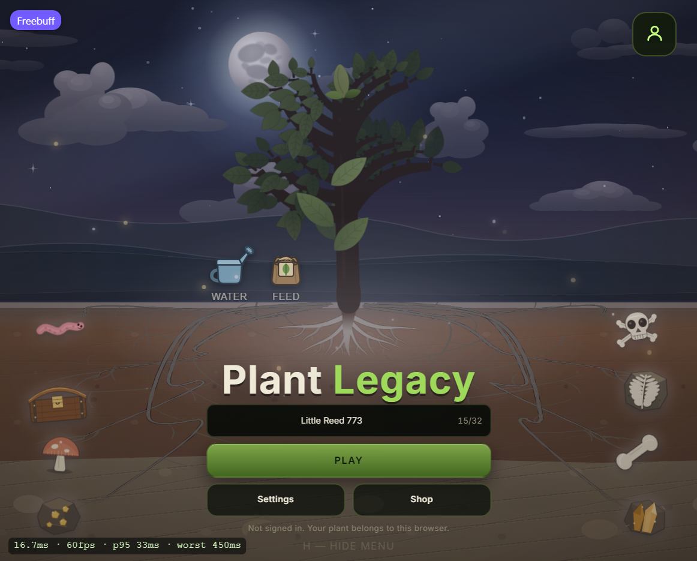
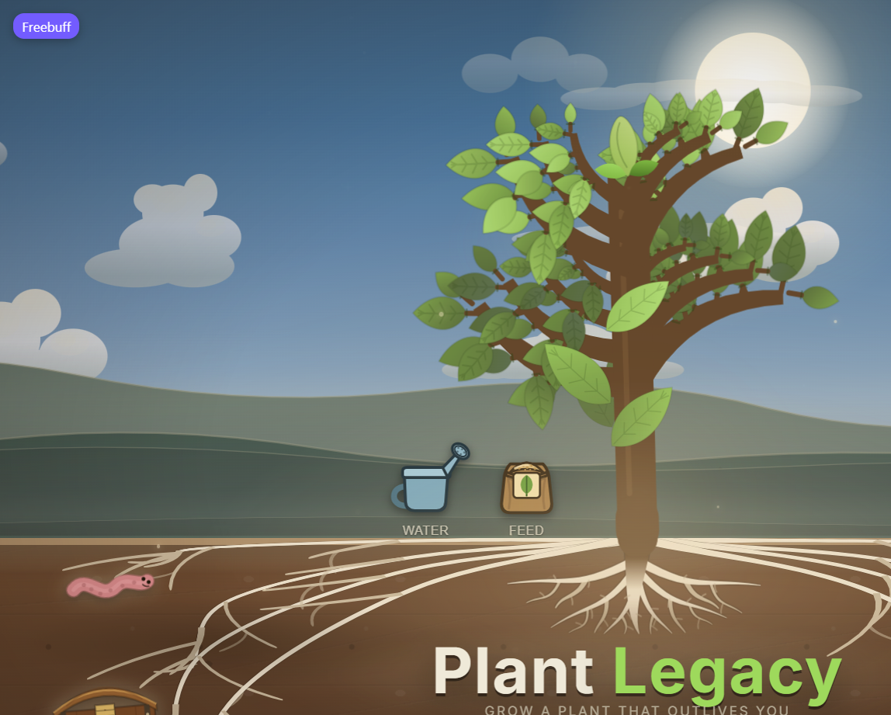

# What works now

Honest list. No feature promises (T42, RULE_13). Updated at every gate.

## Working

- Monorepo, CI, config validator with the rarity ban, Docker image and compose
  stack, `/health` and `/ready`.
- **Title tree and frame time (2026-11-20):** the mature mascot is a tree now,
  not a stem with big leaves on it. Eight limbs leave the trunk at their own
  heights, each one an upward-bending arc carrying a cluster of three or four
  leaves at its end; half the limbs are drawn behind the trunk and half in front
  of it, which is what gives a flat drawing a near side and a far side. The
  leaves ride inside the limb's own group, so the bend moves them - the painters
  no longer place twenty-five crown leaves one at a time. The strain marks are
  bark, not stem green: the compression shadow and the creases down the inside of
  a bent trunk were drawn in `--pl-stem-dark`, and on wood that is exactly the
  green skeleton that used to show through when the tree was pulled over.

  Frame time, measured on the real page in a windowed browser at 1440x900 rather
  than guessed: 12-15 fps at rest before, 59.9 fps now (median frame 16.7 ms, p95
  16.9 ms), 58.5 fps while a drag is bending the tree, 59.9 fps with the camera
  pulled back to 0.55. Three things did it, and one of them was the whole cost:
  the day cycle rewrote ~30 custom properties on the menu root ten times a second
  for values that had not changed, and a custom property there invalidates the
  style of everything below it - measured at 12 ms of style recalculation per
  tick, half the CPU. They now go through `title/styleVars.ts`, which writes only
  a value that changed, and the sky clock is quantised to 1/512 of a day, so the
  palette moves when the sky visibly does. The parallax loop sleeps once the
  camera and the pointer have settled instead of running for as long as the title
  is mounted, and the star field stops twinkling while the stars are transparent.
  `renderFrame` also returns early while the entry screen is up: the 3D scene was
  being drawn every frame behind an opaque 2D world.
- **Spores, shop, collectible drops and a live pouch (2026-11-20):** the shop is
  a server-checked purchase again, not a disabled panel; the purse and pouch are
  on screen during play (spore chip and hotbar); and a death or swarm leaves a
  drop that can be seen, hovered and picked up for spores. Since 2026-11-23 the purse explains itself: every mutation that moves spores (purchase, use, award, drop) sends `LEDGER_ENTRY` (protocol v5) with the label, item, count, signed amount and committed balance, worded by one shared rule, and the inventory panel lists the last 14 newest first; a live use read `Used Starter Dung · +5 spores · 125 left` beside a chip at 125. The pointer pass from
  the day before gives the same world a hover tip that names the exact part, a
  deeper-node pick rule and optional leaf cursors. The detailed records are the
  "Drops, picking and the way out of the earth" and "Shop, spores and the pouch"
  sections below. The `player_state` restart copy landed on 2026-11-22 and every
  pouch and purse mutation is now a row-locked read-modify-write; the remaining
  T08A gap is trade, mail and listing; `items.json` owns the flags (ADR-082).
- One-command local start (`pnpm dev`) and a strict verify chain (`pnpm verify`).
- **T03P networking gate:** two tabs, one server, server-authoritative
  plant state over WebSocket + JSON at 20 Hz. WASD/arrows pan the camera.
  Server validates growth intents (energy, biomass, gene gates, bounds) and
  broadcasts `GROWTH_EVENT` on success.
- **C01 client foundation:** Vite 8 + Three.js r187 scene, orbit/zoom/pan
  camera (`OrbitControls`), WebSocket connection, responsive canvas, lighting
  and shadows. **Input abstraction** with named actions and producers
  (keyboard/mouse), bindings loaded from `/config/controls` (rebindable).
  **UI shell** with layered DOM overlay (hud/panel/menu/modal/toast/tooltip/debug),
  theme tokens as CSS variables, global text-scale (80–150%), toast notifications.
  **Quality controller** with hardware-tier detection and dynamic pixel-ratio
  scaling to hold target FPS. **Debug overlay** (`\`` key) shows fps, frame ms,
  triangles, draw calls, memory, network KB/s. **Pause on hidden tab**.
  Config served via `/config/render`, `/config/controls`, `/config/ui`.
- **The camera follows the ground instead of being pinned to it (2026-11-21):**
  `settlePlayerOnGround` used to write the pivot (head height, 1.6 m) onto
  `controls.target` on every frame. Two things came out of that: a pan downwards
  was undone on the next frame, and the framed subject sat a pivot height below
  the middle of the screen - a fresh seed sat near the bottom edge with no way to
  bring it up. The follow is a delta now: when the terrain under the player moves,
  the eye and the target move with it by the same amount and the view is
  unchanged, but a pan stays where the player put it. The target is floored at the
  ground under it, because a free pan can otherwise bury it and the eye with it
  (`clampEyeToGround` gives up when the target is under the soil - a black
  frame), with the Root Sight cutaway's floor as the one exception. Measured in
  game: a right-drag pan moved the target 20.877 -> 21.950 and it held at 21.964
  a second and a half later; the seed's framing puts it at 0.51 of the pane.
- **The camera stops on a slope instead of collapsing into the plant
  (2026-11-22):** a hard upward drag on a downslope used to shorten the spring
  arm under the orbit floor and then use the shorter arm to justify a lower
  horizon, one drag after another. Measured in the game with one gesture on a
  0.89 slope: the arm went from 3.10 m to 0.25 m with the eye 59.2° below the
  target. Two causes. The ceiling was a closed form per probe, and past
  horizontal that has two answers (the ray's horizontal is `r sin(polar)` and
  shrinks again after 90°), so on a slope it hopped between them and returned
  162.7° while the ray was already under the hill, and permissive angles are what
  shortened the arm into the plant. `player/cameraOrbit.ts` now walks up from the
  top of the orbit and stops at the first angle the ground blocks - one horizon
  per direction - so the arm is never asked to shorten. The same gesture on the
  0.89 slope holds 3.2 m with the eye at 35.1°, and 1.5 m with 37.0°, across
  three drags each. Eight azimuths around the plant at 3 m and at the 1.0 m floor:
  all 16 gestures settle on one pose, the arm never moves, the eye comes within
  5-6 cm of the soil on the low side (13-28° below the target), the seed stays in
  frame in every pose, and the ceiling matches a brute-force horizon to 0.3°.
- **A low camera can look up, and Space never recentres from above
  (2026-11-22):** two camera reports, both measured in the running game. Space
  kept the azimuth but `frameCameraOnPlant` answered a young plant with the
  automatic framing's `camera_young_elevation` (0.55), so a seedling was
  recentred 33° above itself over a screen of unbroken soil; the recenter
  elevation (0.27, ~15°) now applies to every recentre the player asks for - on
  a fresh seed 65.9° above at azimuth 63.4° became 15.7° with the azimuth
  unchanged and the target 0.00 m off the crown. Looking up near the ground had
  no room at all: the orbit target is the plant, 0.15 m over the soil, and the
  camera always looks *at* the target, so an eye below it was under the ground -
  the seed's framing sat 13.5° down with the orbit ceiling already reached, and
  dragging up only turned the view further into the soil. `player/cameraAim.ts`
  leans the view up without moving the eye or the target, by the smallest of the
  eye's gap below the head, the target-to-head room and `horizontal × tan(12°)`,
  and leaves an orbit that already looks up alone. The seed's view is level now
  (it was 19.3° down) and a camera taken down to the soil looks 12° up with the
  plant still in frame; the plant sits lower in the picture for it (0.51 -> 0.70
  of the pane height). Dragged again with real input at two zooms after the slope
  fix: at 3.2 m the seed sits at 0.72 of the pane with the horizon just above the
  middle, and at the 1.0 m floor at 0.80 with the seed filling the lower half - the cap stayed
  at 12°. Root Sight is exempt: the eye is under the soil on purpose there and
  the cavity is read from the aim the player set.
- **The Root Sight shell's clip uses its own mouth plane (2026-11-22):** the
  bowl is anchored on the lowest ground under its rim, but its clip uniforms
  still asked for the ground at the cavity's *centre* as the mouth plane. On a
  slope those are up to a metre apart, so the uphill lip and the wall under it
  counted as above the mouth outside the mouth and were discarded. The clip now
  reads the fitted mouth plane the geometry is drawn on (`fit.lowestGround`). At
  a slope cavity the clip radius is 0.229 m against a 0.225 m aperture with the
  shell at 0.22 m, so no part of the wall stands beside the hole; the bright
  lining still seen through the opening is the single-surface world showing its
  inside, which is D02's.
- **The palette is written per layer (2026-11-21):** the day cycle's custom
  properties used to go on `.pl-menu`, and a custom property reaches every
  descendant: a step invalidated ~1.8k elements and the browser repainted the
  whole title. The paint was the cost, not the recalculation - hiding the world
  layer took a step from 200-250 ms to 50 ms, and a style write measures 0.1 ms of
  script and about 12 ms of recalculation. The properties are now written on the
  layers that paint them: a new `.pl-menu__backdrop` element (the menu's old
  background, moved out so the menu itself carries no palette), each child of
  `.pl-menu__world` (scene, soil stage, plant, root plate), and the weather,
  screen and interface layers - resolved per write (`MainMenu.paletteHosts`), so
  layers created later are covered. The static recipes (`--pl-soil-face`,
  `--pl-soil-detail`) stay on `.pl-menu` and inherit, since they never change.
- **The cut face has its own, coarser clock (2026-11-21):** the soil's seventeen
  gradient layers are the expensive thing to repaint, and the eye cannot read a
  dark cut face moving by a few per cent. The palette is quantised twice - 128
  steps for the sky, 16 for the ground (`GROUND_STEPS`) - and `setPalette` takes
  the ground palette separately, so ninety per cent of sky steps never touch the
  soil.
- **The plant's rim light no longer restyles the tree every two seconds
  (2026-11-21):** `--pl-plant-rim-x` was written on the plant element every sky
  tick, rounded to quarter pixels - and the sun moves a quarter pixel between most
  ticks. That element is 921 SVG nodes with filters: one write measured 70-170 ms.
  It is whole pixels now, one step every twelve minutes of game time. Some other
  per-tick plant write remains (20 in an 8 s window), and a title tick still shows
  occasional 180-230 ms frames.
- **The title's palette steps are half as frequent (2026-11-21):** each step is a
  restyle of ~1.8k elements and measured a 150-250 ms frame; at 256 steps on a
  3600 s day that was a hitch every fourteen seconds, which is the stutter the
  title had. `SKY_STEPS` is 128, one every ~28 s, for a step far finer than the
  eye reads at dusk. Spreading the writes over frames was tried and reverted: the
  cost is per recalculation pass over the subtree, so twelve smaller passes cost
  twelve times as much (four steps took five seconds of 380-460 ms frames). That
  frequency change is the stopgap; the real fix was writing the palette on the
  layers instead of the menu - see "The palette is written per layer" above.
- **Camera (2026-11-19):** the orbit no longer stops at the player's own
  elevation. The polar limit used to be the horizon of the ground plane under the
  *player*, and on flat ground that is exactly horizontal — the eye could come
  level with the seed and not a centimetre lower.   It is now read from the ground
  the eye is orbiting *over*, at four points along the orbit ray (30%, 55%, 80%
  and 100% of it), so a hill under the middle of the ray counts as well as one
  under its end. The angle is solved by the scan in `solveGroundCeiling` now (see
  the slope entry above): the closed form this entry describes asked each probe
  for its own steepest angle and relied on the passes settling, but past
  horizontal that has two answers and on a slope it hopped between them - U05. It stops two and a half contact margins
  short of the dirt, which keeps the spring arm (`clampEyeToGround`) a no-op: it
  used to park exactly on the margin, so terrain noise set the arm going, and
  because the arm shortens the orbit radius the camera crept in towards the plant
  a little on every drag. The arm also gets its clearance right at the target
  end now — the player stands *on* the ground, so demanding 2 cm of air there made
  it give up before it started, and that is how the eye ended up inside a hill at
  the bottom of a drag — and bisects to the crossing instead of stepping in 30%
  jumps. Dragged with real mouse input at eight azimuths: at five of them the eye
  settles below the seed (up to 1.6 m below it) with the view tilted upwards, the
  other three stop at or above the seed on the uphill side; clearance to the
  ground under the eye never went below 0.14 m, and the eye held still to within
  0.002 m with no direction reversals while the drag was held.
- **Night and hidden tabs (2026-11-19):** the world no longer reads as a black
  screen in two situations. Night was the first: at `ambient_intensity_night`
  0.15, `sun_intensity_night` 0.15 and `exposure_night` 0.92 the young-plant
  framing - three metres out and 30° down, per `camera_young_elevation` - was a
  frame of unlit soil with a plant-shaped hole in it (light 0.5 at 19:15). The
  night floor is now 0.28 ambient, 0.30 moonlight and exposure 1.0: dark, but the
  ground keeps its texture and the plant reads as a silhouette. The second is a
  page that is *hidden*: `requestAnimationFrame` stops entirely for it, and the
  low-rate timer loop that draws instead was only ever started by a
  `visibilitychange` event - a page that loaded hidden (a preview pane, an
  occluded window) never got one, so nothing ever drew and the canvas stayed
  cleared. The loop now starts from the visibility state at boot, a resize paints
  once while hidden instead of leaving the cleared buffer, and a one-second
  watchdog draws a frame if the animation loop has stalled for half a second.
- **Title screen (2026-11-20, screen-space pass):** light, weather, pollen,
  fireflies and the vignette were still living inside the world, where each of the
  eight of them was a full-world surface - a 200vw by 230vh layer per effect, ten
  full-frame composites every frame. They now hang in a `pl-menu__screen` layer the
  size of the pane, set on the menu root so they still inherit the palette, and the
  world's painting is enclosed with `contain: paint`. The world itself came down
  from 260vw by 300vh to 200vw by 230vh (the smallest that still covers the pane at
  the wheel's 0.55 limit on a wide, a tall and a laptop window - checked
  arithmetically for 689x657, 1000x625, 1600x900 and 420x860), and the gaussian blur
  over the cloud shades is gone: a full-screen filter was the single most expensive
  thing being asked of the renderer each frame, and it was polishing an edge that is
  a 70% gradient falloff.
- **Title screen (2026-11-20, world and camera pass):** the title scene is no
  longer a picture the size of the window. The world is 260vw by 300vh with its
  horizon 160vh down, and the camera pans and zooms over it, so pulling back shows
  more sky, more ground and more of the tree instead of shrinking a framed
  composition into a box in the void. Every layer inside the world inherits the
  horizon from the world, which is why the ranges, the cut, the finds and the plant
  all still sit on one line. The sky is painted for the whole world above the line
  (deepening towards the top) with a 58vh weather band at the horizon for the sun,
  moon, stars and clouds; the ranges are drawn without `slice` so their ridges
  survive a wide box; the farthest range takes the colour of the air in front of it
  so three planes of night-green read as distance instead of one flat band. World
  layers that used to be placed against the bottom of the pane (foreground blades,
  bedrock, hearth, verge, finds) are anchored to the soil line instead. The world
  clips its own painting, so the foreground blur no longer leaks past the scene as
  dark smudges. Verified at zoom 1 and at 0.450 (the wheel's pulled-back limit) the
  world still covers the pane completely.
- **Title screen (2026-11-20, scene and growth pass):** the title is a place now,
  not a backdrop: a band of air where the ranges meet the sky, a hedge of blades
  closing the bottom of the frame, and fireflies that only come out when the scene
  is dark (they ride the same measured darkness as the cloud shadows and the
  hearth). Growth is the drawing filling out rather than one drawing scaled: leaves
  arrive one at a time in the order a shoot makes them (oldest front leaves, then
  the back pair, then the crown from the bottom up), the trunk's stroke widens from
  13 to 21 units with age, and the wood reaches 81% of the stem, so a grown plant is
  a trunk with a crown on it instead of a green stalk holding a canopy. The seed and
  sprout states are still the bottom of that range. The lag had two structural
  causes and both are gone: a four-function CSS filter on the whole plant (it
  re-rasterised fourteen gradient leaves and the root plate every frame the leaves
  moved) and full-screen `mix-blend-mode` passes on the cloud shadows and the
  hearth. Measured at 689x658 the scene ran at a 16.7ms median; larger panes could
  not be measured in this environment because frames do not run in a hidden tab.
- **Title screen (2026-11-20, one-plant pass):** the plant and its roots are one
  drawing again. The plate under the stem was laid at 51.25% of the art box while
  the shoot was 41.67%, so the same drawing units measured 23% bigger underground
  than above it: the taproot came out wider than the trunk it hangs from and the
  two halves read as two drawings stacked. Same width, same units, and the crown of
  the plate is the trunk's own bark, so the joint is invisible. The second root
  system is gone: the reaches that ran from the stem to each buried find were a
  fan crossing the plate, which read as a second plant buried beside the first - the
  rule that decides which find a stage reached is kept, nothing is drawn for it.
  The green stripe up the middle of the trunk and the bright rim on every leaf are
  gone (a highlight on a cut-out drawing reads as a sticker), and the trunk thickens
  once the plant is mature. Growth is no longer a sapling drawn larger: the ceiling
  is 1.35 instead of 0.6, the pane fit reserves the sky for the *grown* tree, and
  the last part of the range is wood - a wider trunk, not more height. The sway was
  the whole plant leaning 1.7x the motion function; it is 0.5 now, and the leaves
  flutter on their own `translate` animation so the foliage moves instead of the
  tree tilting. Watering or feeding plays a happy dance (shake plus fluttering
  leaves); four actions inside six seconds and the plant goes groggy - half-speed
  sway, a slow wander off upright, and a slack colour - until it sobers up. The
  chest's dark mouth is part of its open state now (it showed as a strip of soil
  between lid and body when shut) and the lid closes again after its beat. Clouds
  enter from the upwind edge instead of appearing mid-sky. The camera pulls back to
  0.55 and the world has a backdrop, so pulling back shows more of the place rather
  than a black border. Night is a deep blue room with a warm hearth on the soil, and
  the title scene's per-frame cost is down: the parallax writes nothing at rest, the
  mascot paints at 30 fps, and the moving layers are composited planes.
- **Title screen (2026-11-20, sky and camera pass):** the tree is twice the height
  it was and the plate below it grows with it. The taproot was 11 units wide with a
  taper exponent of 1.9 while the laterals were 4.2 at 0.85, so the centre of the
  plate was the thinnest root in it and the roots spreading out to the sides were
  the widest; it is 17 at 1.0 now, and root depth runs 0.74 to 1.04 across the care
  range, so the roots stop staying a seedling under a tree. The stem ends at y=-30
  (254 units of drawing against 190) and the art box carries 140 units of gutter
  each side, so a hard bend curls inside its own frame instead of being cut into a
  small rectangle; the pane fit reserves the sky for the *grown* tree
  (`PLANT_MAX_SCALE`) and caps the sky at two thirds of the pane, because a plant
  whose height does not enter the fit is a plant that grows through the top of it.
  The sky is a table now (`title/skyLayout.ts`): fourteen clouds in six families,
  each crossing in its own time, with the soil's shadows built from the same rows so
  the weather above and below is one event, and one size for both the sun and the
  moon. Two more ranges (mid, near) join the far hills for the parallax, and the
  wheel, `+`, `-` and `0` move a camera the world eases towards, scaled from the
  soil line up.
- **Title screen (2026-11-20, tree and underground pass):** the roots to the
  buried finds were a second root system. They were stroked paths in the ground
  layer while the roots under the plant are filled tapered shapes, so eight thin
  pale wires crossed the plate's fan and the soil read as two drawings stacked.
  `rootReach` in `title/roots.ts` builds each reach as the plate's own drawing - a
  closed ribbon that leaves heavy and arrives fine, with an ink copy one edge wider
  under it, feeders included - and it now starts where the plate is thickest
  instead of at the stem's foot in the middle of the fan, so it continues that fan
  rather than crossing it. The ribbon divides its sideways offset by the cut's own
  3.3:1 proportions (`RUN_ASPECT`), or every vertical root comes out as a fat
  horizontal slab; `roots.test.ts` checks the closed shape, the ink under the body
  and that the run arrives on the piece it reached. The base of the plate was
  painted with the *stem's* green for its first sixteen units and the shoot's own
  foot was a green rectangle on the soil line: both are bark now - `pl-root-bark`
  ramps dark bark into pale root - which is the colour a tree of this age has.
  The plant also became a tree by using the drawing it already had. The art's box
  is 224 units tall and the stem stopped at 84, so the top third of every plant was
  empty gutter that scaling could never reach. `STEM_TIP_Y` is 34, the crown moved
  up with it (seven canopy leaves instead of six, and larger), the trunk is wider
  with four limbs instead of two, and the stem's foot is bark. Same box, same soil
  line, a plant 38% taller - and the crown does not sit against the top of the pane,
  because the care ceiling stayed where it was. A tree's leaves are deeper than a
  sprout's too: `.is-tree` moves the two tender stops and nothing else.
  Pressing H hid the menu's opacity but not its controls. They set
  `pointer-events: auto` to stay clickable through the scene layer, and a child
  that opts back in ignores the parent's `none`, so the invisible Play button still
  started the game. `is-ui-hidden` turns the controls off and then takes them out
  of the tab order after the fade. The ground the parallax uncovers is now the same
  ground as the cut: pebbles, clumps and bedding planes live in `--pl-soil-detail`
  and both elements paint it, the grass lip is shared, the drag clamp went 90 ->
  140 px with the bleed and foreground overscan to match, and the sun and moon are
  one 11.6vmin disc. Clouds: the low bank in the bottom-right corner (the sausage)
  is gone, two shapes were added with a fourth high wisp, and the drift is 18% of a
  cloud's own width on each cloud's own duration instead of 2.2% over two minutes,
  which was a still sky with an animation in the file. The fern fossil is a fern
  now rather than an ammonite coil - eight pairs of swept pinnae with a dark print
  under the pale leaf - and the chest is wider, shut, and full of more than gold:
  coins, three cut stones, pearls, a crown and a ring that are not drawn at all
  until the lid lifts, because a shut lid that shows its gold is a picture of a
  chest. The lid lifts off the rim and tips back (620ms, ending at -27px / -13deg)
  instead of snapping 38 degrees and back like a clapperboard, and the open state
  does not depend on the animation: reduced motion gets the same chest, still.
- **Title screen (2026-11-20, generated roots):** the root plate under the
  seedling is generated now, and the hand-authored table it replaced is gone. The
  table was fourteen spines typed as literals; `buildRoots(seed)` in
  `title/roots.ts` grows the plate from a taproot and three laterals a side, each
  forking off its parent's own centre line, with hairs placed from each spine's
  geometry rather than typed as free paths, and every spine pushed through
  `fitToGrid` so an outline can never leave the 200 x 58 grid it is drawn in - the
  table had no such guarantee, and a widened root could poke out of the art's cut.
  The first generator pass was worse than the table and was replaced in turn: it
  mirrored the two sides, drew every fork from the parent's *base* width (which put
  a knob on the end of every lateral) and grew the plate by truncating each spine
  along its own curve. Truncation is the one that showed: a part-grown plate was a
  fringe of short stubs and a grown one was a ball of strings, because extension
  makes a root longer without making it thicker. Growth is a scale again - the same
  drawing, scaled about the soil line - and `rootDepth(points)` is the roots' share
  of the plant's own care scale, 0.85 to 1, so it can never outgrow the drawing that
  carries it. That property had looked inert all along: the plant's `> svg` rule
  already scales every child by the care scale and wins on specificity, and a second
  transform on the same element replaces it rather than adding to it. The plate is
  composed the way the deleted table was: the two sides are not mirror images (a
  plate of matched pairs is a bouquet, and that symmetry is what read as a tangle),
  the shallow laterals leave and arrive within a few degrees of level and get their
  droop from a bow on the chord's normal rather than from a steep arrival heading
  (which drew fronds), the taper exponent is below 1 so a long root keeps a body
  instead of thinning to a hair for its last third, and the buttresses are gone:
  they doubled the shallow laterals into a winged wedge under the trunk. It is drawn
  at 88% of the shoot's width instead of 71%, because a root plate reaches wider than
  the trunk. The strands that led nowhere are gone entirely (see below); the ground
  now holds the plate's own fan and the reaches to a find, nothing else.
  `roots.test.ts` was rewritten against the generator: every root starts inside
  another one, the taproot joins the stem at exactly the stem's width on the soil
  line, every spine tapers monotonically to a point, every spine sags off its own
  chord, nothing leaves the grid including the skew of an angled cap, the plate
  covers most of its grid and is not mirrored, and the roots' share of growth is
  monotonic and capped at the plant's own scale.
  A second review fixed two things that only showed at full care. Forks left their
  lateral at 0.8 of its length, where the lateral is thinner than the feeder coming
  off it, so the feeder's flat start showed either side of the root it came from:
  roots that looked sliced off. They leave at 0.36 and 0.62 now and are always
  narrower than the parent there, which `roots.test.ts` checks for every spine. And
  a reach to a buried find was one cable of constant width from the stem to the
  piece; each is three lengths of the same curve with falling weight plus three
  offshoots, so it thins as it travels and branches instead of being a long thick
  root. The strands under the plant that led nowhere were removed rather than tuned:
  stroked they read as wire beside the plate's filled roots, given weight they read
  as pale straps at low care (the plate is small then and they do not scale with
  it), and filled shapes in the plate's own outline still read as bands hanging off
  the foot. The plate already fills the near ground, so the ground now holds the
  plate's fan and the reaches to a find, nothing in between.
- **Title screen (2026-11-20, roots pass):** a review of the tree pass turned up
  one real duplicate and several leftovers. Root depth was written twice, in two
  modules, with two different formulas (1.7 against 2.6, one counting stages and
  one counting care points); it is one function in `title/roots.ts` now, and the
  plant reads it. The root-run path generator moved out of `title/treasures.ts` into
  `title/roots.ts` beside the rest of the root geometry, and a run's body is drawn
  in the plate's own pale instead of a separate colour, so the roots under the plant
  and the roots reaching a find are visibly the same system. The roots are a tree's
  roots now: two buttress spines leave the base at the soil line and spread before
  they dive, with hairs on them, since every other root left the stem below the
  surface and the base read as a cutting. The plate grows on both axes instead of
  being stretched vertically - `scaleY` made each root longer and thinner rather
  than bigger - with `overflow: visible` so a widened plate is not cut off at the
  sides, and the ceiling came down to 1.35 for the same reason. `roots.test.ts`
  grew the checks for the two (a buttress has to start below the line, or half its
  width is in the air). Three leftovers went with it: the leaf painter kept three
  parallel arrays keyed by index (one list of leaf parts now), the bud carried an
  extra element and a second ref just to hold its flick (folded into the anchor's
  own rotation), and the chest drew a rim strip the curved band already covered plus
  the lid's glow twice. The ground bleed and the stage now take their soil ramp from
  one `--pl-soil-face` custom property rather than two copies of the same gradient.
- **Title screen (2026-11-20, tree pass):** the leaves were coming off the tree
  when it bent, and the cause was one property. A leaf was rotated with a CSS
  `transform` and a `transform-origin` written in the art's own units - but the
  element also had `transform-box: view-box`, which measures the origin from the
  viewBox corner, and the viewBox starts at x = -40. Every leaf in the plant was
  therefore pivoting forty units to the left of its own stem attachment. Placement
  is an SVG transform attribute now (in user units, about the attachment) and the
  only thing moving a leaf is the CSS `translate` property, which no origin can
  skew, so a leaf's base lands on the bent spine and stays there. The hover tilt
  went with it: a CSS rotation there pivots on the drawing's corner too, so the
  hover highlight is a light change, not a movement. The mascot is a tree now, not
  a stalk: from the young-plant stage the bottom of the same spine is drawn again
  in bark, one width wider, with a flare at the soil and two branches off the
  upper stem (`bendArcSegment` in `title/plantBend.ts` returns any part of the
  bent arc, so the trunk and the stem are one curve and cannot drift apart), and
  at five care points a five-leaf crown appears at the top. Growth no longer stops
  at the last stage: the care count is unbounded, the stage table is only the art
  state, and the drawing keeps scaling - smoothly, with a soft ceiling so it stays
  in the scene - while the roots keep deepening to 2.6x. The cut also has ground
  either side of it now: the parallax slides the soil band, which used to take its
  own edge off the pane and show sky through the cut, so a wider copy of the same
  soil sits behind the stage and moves at 0.9 with it (`.pl-menu__ground-bleed`).
  Three finds were redrawn because detail had turned into noise at 80 px: the
  skeleton is a skull over two crossed bones with knuckled ends instead of a skull
  with a rib, the fossil is a coiled ammonite pressed into the slab instead of a
  fern whose fronds read as scratches, and the leg bone is one femur silhouette
  with two lobes at each end and a lit edge instead of a bar with corners.
- **Title screen (2026-11-20, polish pass):** the light rectangles in the sky
  behind every cloud were the cloud's own `clip-path`. Three passes removed
  shapes that had corners - a shade band, then a gradient path - and the box
  survived all of them, because the clip region is a shape the compositor blends
  as one: a rectangle the size of the SVG, visible wherever the cloud was thin.
  There is no clip now. The base is trimmed by geometry: a puff that would hang
  below the base line keeps its centre and has its radius shortened until its
  bottom sits on the line, and the numbers are rounded down so rounding cannot put
  it back under. `cloudArt.test.ts` pins it - no `clipPath`, no `mask`, no ellipse
  under its own viewBox, and at least three puffs of different widths forming the
  base. The sun and moon are the brightest things in the scene again: the sun is
  wider, with a tight white bloom on the rim under a wider corona, and the moon
  carries a cool two-stage drop shadow, so neither reads as the same value as the
  sky around it. The buried finds are drawn in more detail at the same size: the
  chest has planks, iron bands and rivets, a keyhole and a gem in the gold; the
  skull has a lit brow, cheek shadow, teeth and a crack; the fossil gains broken
  faces and chips; the crystal a third facet and sparkles; the ore a fourth nugget
  and rock planes; the bone a marrow groove; the worm segment shading; the
  mushroom gills. Water and feed no longer do the same thing: water falls as
  droplets and rings off the soil and pulses the leaves, feed scatters as specks
  of meal and swells the whole plant, and the two react different plant parts.
  Carrying a prop bobs and tilts it, lights the plant up while it is held over it
  (`.is-carry-target`), and the drop leaves particles in a dedicated layer; the
  carried clone also clears `box-shadow`, `outline` and `border-radius`, so a
  focus ring cannot ride along as a box. The plant grows at every action rather
  than per stage: the menu passes the running care count and `setGrowthStage`
  interpolates between the stage scales (and the root depth) with `Math.floor`
  choosing the art state. The grab cursor is no longer the default - the scene
  inherits the plain leaf arrow and only switches to the closed-leaf grab while
  it is being dragged or the plant is bending - and the plant's parts take the
  pointing leaf, because they can be dragged. The cut is one picture with the
  hills: the stage, the plant and the care props translate with
  `--pl-scene-drag-x` (0.9 / 1.1 / 1.1) horizontally, and the root-run layer moved
  into the world above the soil, below the menu, at 0.9 with a quieter stroke.
- **Title screen (2026-11-19, care pass):** the plant on the title screen now
  starts as a seed and grows. Three states share one drawing box, so they all stand
  on the same soil line: a seed half out of the soil (stage 0), a two-leaf sprout
  (stage 1), and the bending plant, which arrives small and fills out stage by
  stage. Care is not rationed any more - the once-a-day rule made a save depend on
  the calendar and turned the loop into a timer - so every watering or feeding is
  one step, stored as a single number in `localStorage['pl-title-care']`. A sprout
  reaches nothing; from the young-plant stage on, each step sends one root run out
  to the next buried find (`rootRunPath` in `title/treasures.ts`), drawn as a pale
  root from the stem's foot and animated with its own dash offset, and the find is
  marked and announced. There are eight finds now, in two columns of four: an
  overlap bug came from placing pieces by width alone, because the ground is about
  three times wider than it is tall, so a 7.5% wide chest is 22% of the band's
  height and landed on the piece below. Positions are rows spaced further apart
  than a piece is tall, the art's size is capped in `vh` (10.8vh, about 20% of the
  band on any pane), and `treasures.test.ts` checks the boxes at three pane shapes.
  A prop can be dragged: carried to the plant it is given, put down anywhere else
  above ground it is wasted (with a caption saying so), and brought back to where
  it stood it is put back with nothing spent. A press that never travels is still a
  tap. The carried copy is a clone with its own class, so it no longer sat in a
  white button box, and a lost pointer capture removes it. The sun's wash is gated
  on the disc (`sunWashGate`): the palette's glow faded slower than the sun set, so
  for a few minutes every evening a screen-blended yellow wash covered the title
  with no sun in the sky. The wash is a 44vmax halo now, not a full-pane gradient.
  The default cursor is a pointer again - a green arrow with a midrib and a dark
  rim - because three attempts at a leaf-shaped arrow read as a seed or a pod; the
  leaf shapes stay for hover and grab. Bedrock lost four of its seven pebbles, its
  fine fourteen-point torn edge and its drop-shadow; the buried art lost the facets
  and cracks that turned into noise at 60-90 px.
- **Title screen (2026-11-19, evening pass):** the camera keeps its own line of
  sight. `frameCameraOnPlant` used to pick a fixed azimuth and elevation, so
  pressing space swung the view round to a scripted angle and the click read as a
  spin rather than a zoom; it now reuses the current eye-to-target direction (with
  a fallback for a brand-new camera) and only clamps the rise, and
  `focusCameraOnNode` keeps the player's current `riseRatio` inside its own limits
  instead of forcing ±0.3, so a double-click lifts the node into the middle of the
  screen without turning round to face the other way. The mascot bends to
  `MAX_BEND_DEG = 168`, and the canopy no longer comes apart while it does: each
  leaf turns only `0.55` of its stem's tangent (`LEAF_TURN_FOLLOW`), droops with the
  bend and is clamped to ±132°, and the whole-canopy sway is scaled by
  `1 - 0.72 * bendFraction`, which is what stopped the top leaves whipping out of
  the drawing at deep bends. The scene's near foreground and cloud shadows now read
  `--pl-scene-drag-x/y`, published only while a drag is held, so the whole picture
  moves under a held pointer and nothing moves when the pointer merely crosses it;
  a press inside `.pl-title-plant` never starts a scene drag, so bending the plant
  and dragging the hills cannot both happen. The sun gained limb darkening and a
  corona, the moon maria, the clouds a shaded base, and the soil a grass lip,
  bedding planes and six buried finds (`title/treasures.ts`: a chest, a worm, a
  skull, a fern fossil, gold ore and amber crystals, each tilted and clickable with
  its own reaction). The care loop stands beside the plant: a watering can and a bag
  of feed, once each per day, one stage per action for seven stages, persisted in
  `localStorage['pl-title-care']` and reset by date. A stage scales the drawing
  (`--pl-care-scale`), deepens the roots (`--pl-root-depth`) and grows two more
  leaves; each stage's roots reach one buried find, which is announced and marked
  `is-reached`. The growth gizmo's pick is 3D now: `pickGrowthAimNodePoint` rejects
  a hit when the drawn plant is nearer than the node's own sphere, and
  `branchAttachAnchor` clamps to the node's own drawn radius instead of 1.6 m, so
  the ring can no longer be parked on the parent a child root grew from. Node picks
  use each part's drawn position and its own size rather than a flat 0.35 m sphere
  on the server position. `ui/cursors.ts` adds leaf-shaped cursors (arrow, pointer,
  grab) applied through `html[data-pl-cursor='plant']`, with a **Leaf cursor**
  switch in Settings that remembers `localStorage['pl-cursor-theme']`. A follow-up
  pass removed the grey rectangle that sat behind every cloud: the shaded underside
  was a full-width path with a CSS mask, and the mask was not clipping it, so each
  cloud was drawn inside a visible box. The shade is a gradient fill now, spanning
  only the puffs that cross its own top edge (`cloudArt.test.ts` pins both). The cut
  in the soil gained the stone layer it was missing - a bedrock band from 46% of the
  ground with a torn top edge, bedding planes and pebbles - and the ore, crystal and
  fossil were moved into it, redrawn as a chunk with a gold seam, an amber pocket in
  rock and a frond in a broken slab, so they read as finds in stone rather than
  shapes on soil. The skull got a jaw, cheekbones and teeth; the watering can became
  a can with a raised spout and a rose; the feed sack got a tied paper top and a leaf
  label; the leaf cursors got a stem into the hot spot and a bright inner edge, and
  fall back to the system pointer under forced colours. On 2026-11-22 they also
  reached the scene: OrbitControls' inline `cursor: auto` on the canvas was
  clearing the themed rule, so only DOM panels showed a leaf; each leaf now ships
  as a PNG in front of its SVG because Chromium drops a refused cursor image
  without an error and silently shows the Windows arrow.
- **Title screen (2026-11-19):** the scene drags as one picture. The near
  foreground and the cloud shadows read the far layer's own offset (published as
  `--pl-scene-x/y`), so grass pans further than hills instead of standing still
  under a moving backdrop, and each hill layer carries a skirt of its own colour
  below the horizon so a vertical drag can no longer open a strip of sky between
  the hills and the soil. The sun and moon are sized in `vmin`, not `vw` behind a
  pixel ceiling: a px cap is what made the moon shrink when the browser was
  zoomed out, because the hills kept growing with the frame while the disc had
  stopped. The mascot bends to 120° (`MAX_BEND_DEG`) and says so: the stem is an arc
  (`title/plantBend.ts`), not two hinges, and its curvature is weighted towards the
  tip (`bend * t^1.2`) because a rooted stem is stiff where it enters the soil and
  gives above its middle — an even arc leaned from the base and read as a bent
  wire. Arc length is preserved by integrating along unit tangents; every leaf and
  node nub rides the arc at its own attachment, and the leaves droop a further 15°
  towards the ground. The strain is drawn: the stem thins 11 → 8.4 units, three
  creases cross it and a compression shadow runs down the inside of the curve, both
  fading in only near the limit, while the sunlit side brightens. The drawing's
  viewBox carries 40 units of empty gutter on each side of the 200 the art uses,
  because a canopy swung either way reaches past the art's own width and was being
  cut off square at the edge of the drawing; the plant's box is 1.4× the art to
  match, its footprint and height are unchanged, and the padded gutter takes no
  pointers so a press beside the plant still drags the scene.
  `title/plantSound.ts`
  synthesises a creak from the physical model rather than from taste. Each slip is
  a short excitation into a wooden body (four band-passed modes at 140-480 Hz, two
  short panel delays, the dry impulse mixed in, a quiet 3 kHz squeak edge), fired
  by the stick-slip generator of Farnell's *Designing Sound* door: a static
  threshold below which nothing slips at all, and a slip rate rising from ~1 Hz to 240 Hz with the pull. Since the slip
  rate is the creak's pitch, a faster pull creaks higher; a stem held still is
  jammed and silent; letting go answers with a falling amplitude-modulated groan,
  a tail of spreading slips and a wooden knock. A review cut the graph back: the
  continuous strain oscillator with its LFO and tremolo, the third panel tap, the
  690 Hz mode, the groan's noise tail, and the mutable force accumulator that was
  nudged on every pointer move all went — one `forceNow()` decay is read when a slip
  is scheduled. Scheduling is a single self-timing pump (35 ms, 120 ms lookahead on
  the audio clock) instead of an interval plus a guard. A **Sound** switch in
  Settings silences it for good: the preference is module-level
  (`localStorage['pl-plant-sound']`) with a registry of live instances, so it mutes
  every plant rather than the one it was switched from. `plantSound.test.ts` and
  `plantBend.test.ts` pin the arithmetic. The scene is warmer: a soft pool of sun-coloured light lies on the soil
  around the stem, ten pollen motes lift off the meadow, and the vignette is warm
  brown instead of black. The account popover's small print is a caption in its
  own flow now, so it can no longer sit behind the Create account button.
- **Title screen (2026-11-18):** a 2D cutout scene with four parallax layers
  that drag and follow the pointer, an interactive mascot plant above the
  logotype, a nickname box with generated defaults, Play / Settings / Shop, and
  an avatar in the top right for signing in. `H` hides the menu and leaves the
  scene. Sign-in and the "Plant a new seed" card open over the scene.
  `GET /world/time` serves the world clock to it, so the menu and the game share
  one hour. `apps/client/src/ui/MainMenu.ts` owns the DOM; `title/TitleScene.ts`,
  `title/TitlePlant.ts`, `title/parallax.ts`, `title/plantMotion.ts` and
  `title/plantName.ts` hold the behaviour. The old entry card is gone. The client now calls `/auth/signup`, `/auth/login` and
  `/auth/refresh`; until this it had no auth UI and never obtained an
  `accessToken`, so accounts were unreachable from the game even though the
  server supported them. An expired access token is refreshed before `HELLO`
  (the server answers a bad token with `AUTH_FAILED` rather than falling back to
  guest), and a refused refresh drops the dead session. Sign-in needs the
  Postgres-backed account service; without a database the form reports
  "Accounts are unavailable right now." Covered by
  `apps/client/src/ui/EntryFlowStateMachine.test.ts` and
  `apps/client/src/auth/authClient.test.ts`.
- **T00A onboarding:** dismissible three-line hint card and tooltips on the
  light / water / minerals readout, loaded from `/config/onboarding`.
- **Growth economy (2026-11-12):** roots capture water and minerals from the tile they occupy (`absorbResourcesFromTiles` + `ResourceWorld.takeFromTile`, so ambient supply is finite and actually debited); photosynthesis converts *light level* plus the plant's own stored water and minerals into energy, and is now the only income channel — it no longer creates structural biomass, so sprouting a radicle can never inflate the seed. Cotyledons count as photosynthetic organs. Respiration burns energy day and night (a lone ungerminated seed is the only exemption), water loss drops to `night_transpiration_multiplier` at night, and a plant only loses structural mass when it has no energy left. Growth after establishment additionally requires stored water/minerals. Storage capacity is derived from the plant's own biomass, never a global cap. Covered by `apps/server/src/ops/growthEconomy.test.ts` (establishment → capture → stem, no biomass from light, night drawdown).
- **T04 mutation (2026-11-14, partial):** data-driven mutations in `config/mutations.json` (27 definitions across colour, diet/metabolism, size, growth rate, unlocked node types and movement; three kinds of trigger), acquired on a completed growth event with configurable chance, weighted by adaptive pressure over eight growth categories, gated by tile light/moisture/minerals, weather and day/night. Maintenance drains energy, then biomass, and biomass stops at `upkeep_biomass_floor`: an unpaid bill stalls the plant but never sheds a mutation and never kills it, so the only way one leaves is the owner shedding it (biomass penalty, cooldown); pressure decays with a configured half-life A size mutation is **real tissue**, not a shader scale: it holds `m³` the mass and is drawn `m×` as wide from that mass, so shedding one leaves the plant over-built and it wilts back to its regular size over minutes (`oversize_decay` wilt/leak rates), never in a single frame. Mutations also have levels: the player spends stored energy and biomass and picks one card per level from that mutation's own effect pool (`MUTATION_LEVEL`), upkeep climbing with each level, with levels and chosen cards persisted in PLNT v4. `mutation_acquired`/`mutation_shed` fire on the event bus; PLNT snapshots are v2 (v1 still loads); protocol v2 adds `MUTATION_STATE`/`MUTATION_SHED`. The client shows the set, its upkeep and the pressure readout with a shed control. Appearance is data: `config/mutation_visuals.json` carries one style per mutation (organ family, pattern, tint and strength, variegation, glow, bark thickness and darkening, thorns) and the client paints from it. Every held mutation is composed into one look per organ family — foliage, woody, seed, bloom — plus a whole-plant look for the billboard tiers, so a plant shows a bark mutation on its trunk and a lamina mutation on its leaves at the same time instead of a single strongest signature. Tints multiply and clamp, variegation and darkening stack as `1 - product(1 - v)`, glow adds, and bark thickness and thorns have ceilings; levels amplify a style so a levelled mutation looks stronger. Geometry follows the name: `thickened_bark`-family styles thicken tubes, `spined_epidermis` draws real thorns, `columnar_habit` and `drooping_fronds` bend growth direction before the gene clamp. The WebGL SDF fallback still paints one organism and maps the composed foliage look onto its three mutation uniforms. Record: `docs/tasks/T04.md`. A dev-only **mutation gallery** (`dev_mutation_gallery`, Plant → Mutation Gallery in the Dev Panel) builds one plant per mutation on an eight-column grid in front of the asking player, ten metres apart. Each showcase plant is granted its mutation *first* and then grown to a mature 20–34 node body — roots, a five-internode column, leaves, branches, and the organs that mutation talks about (a `trunk` or `culm` column for those unlocks, thorns for `spined_epidermis`, a rhizome with tuber and stolon, pneumatophores, blooms) — and its tissue is filled to the mutated quota, so a size mutation stands in the row at full size instead of being outgrown. Any organ the growth rules refuse is reported back in `rejected` rather than silently thinning the plant. Rival plants carry a name tag above the canopy with the mutation they express.
- **Water as a medium (2026-11-16):** water is no longer only a surface you look *at*. `renderers/environment/underwater.ts` answers "how much water is over the eye?" from the water field's own surfaces (`waterSurfacesAt`), and the renderer applies the consequences: a fog that pulls in to metres and takes the water's colour, a dimmed sun (Beer–Lambert `exp(-depth · k)` on the beam), and a water shader that shades its **underside** as Snell's window — a bright, rippling opening straight overhead, dim self-reflection beyond ~48.6°. A damp ankle is still air: immersion starts at 6 cm over the eye. The sheets themselves end radially (`sheet_edge_fade`), because a square grid seen from a high camera drew the water as a square.
- **A planet-wide sea (2026-11-17):** the world has an ocean, not just local water. `renderers/environment/ocean.ts` builds one dome over the whole play area whose height is the planet's own curvature (`y = sea_level_m − r² / (2·planet_radius_m)`), so a single mesh covers every direction: no sheet edge, no LOD seam, and no reachable place without water. Its coastline is not authored — the terrain is drawn at the same radius, so a shore is wherever the ground rises through it — and it draws with the same water material in **ocean mode** (`uOceanMode`), where the shader measures the column down to the ground grid (pale shelves, dark basins) instead of a per-cell depth, skips the "water above the ground" discard that would delete it, and softens its last 25 cm at the shore instead of cutting a polygon edge. `sea_level_m` (6 m above the play area's tangent plane, so the 5.6–20.8 m plateau stays dry and the basins flood) and `ocean_enabled` live in `config/water.json`; the sea is appended to `waterSurfacesAt`, so a step into it is water over the eye rather than clear air. The first attempt was a sphere of `planet_radius + sea_level` with 80 rings — its polar cap is a chord, so 900 m out the water lay ~17 m *below* the terrain that should have been under it and the ground covered the sea everywhere; the analytic dome has no such sag. The horizon is the camera's far plane, so the water fades out at 2.2–2.48 km rather than ending in cut geometry.

  The sea also carries its **own bed height field** (`buildBedTexture`, 640² samples over ±900 m). The water field's grids stop at 180 m and 560 m, which left the shore players actually look at — the plateau rim 600 m out — with no depth sample at all, so every fragment there fell back to one constant column and the whole ocean shaded as a single flat grey band. With the bed, the shader has a shallow-to-deep gradient all the way out. Its **wave field** is three octaves in ocean mode (`seaNormal`: a long swell, a wind chop, a fine ripple) whose slope is carried into the sky reflection, so the surface bands like moving water and the sun writes a broad glitter path (`sea_wave_strength` 1.2, `sea_wave_scale_m` 5.5); a **foam line** sits wherever the water is shallower than `sea_foam_width_m` (0.9 m), which is what ties the sea's edge to the ground rather than to the dome's outline. The sea's material is transparent and **`depthWrite` is false** (`TRANSPARENT` single layer, side chosen from where the eye is), so the ocean can never occlude the rain, the plant or the bed under it; the shallow shelf shows the ground through the water, and rain streaks draw over the sea.
- **Water as environment (2026-11-15):** water is no longer a Root Sight ornament and it is not fitted to anything. Two fields, both from the simulation:
  - **Rain puddles.** Rain adds depth to a shallow-water sheet; the mass-conserving solver in `packages/shared/src/world/surfaceWater.ts` runs it downhill into hollows, where it soaks in and evaporates. Puddles therefore appear on the ground whether or not Root Sight is open.
  - **The water table.** `ResourceWorld.getWaterTableHeightAt` reads the per-tile groundwater the server already simulates (saturation puts the table at the *regional* ground level — the undug terrain averaged over `groundwater_table_smoothing_m` — and an empty cell sits `groundwater_table_depth_m` below it), so the level rises with rain, falls as roots drink, refills from wet neighbours, and low ground pools instead of every tile tracking its own bumps. Measuring against the regional level is what keeps a dug tunnel from acting as a drain: the table stays put and the hole fills. Its height field is streamed in `RESOURCE_UPDATE.waterTable` (48 × 2 m cells, twice a second) and drawn as one continuous mesh: nearby water connects, and terrain—not a fitted disc—hides it where it is underground. The Root Sight pit is the hole through which that same surface is seen from below. That hole is cut in both faces of the double-sided soil skin: a front-face-only cut left the earth a closed ceiling from underneath, so the cavity could be seen from outside and from above but not from inside the ground. The earthen lip stays a surface effect and fades out with the eye under the soil, which is what the old front-face gate was really there for.
  - **Depth and wet ground.** Both surfaces carry their water column in an `aWater` attribute and shade it with Beer–Lambert absorption (`water_absorption_per_m`), so a deep body is dark and a shallow film is clear, while Fresnel reflection still makes a pool a sheet of sky at a glancing angle — deep water brightens where it reflects. The soil under and around standing water is stained darker by a damp layer that follows the puddle field, spreads `wet_ground_halo_cells` past the edge and fades at `wet_ground_dry_per_s` after the water soaks away, using the soil shader's own wet colour; that layer skips its spread and per-vertex writes entirely while the ground is dry. Underground, the soil shader samples the same table as a small height ramp and darkens everything below the waterline (plus a metre-scale capillary band above it), so the walls and floor of a pit or tunnel that holds water look soaked — the surface stain layer never reaches down there.
  - **The river.** The route is surveyed from the terrain, not authored: `packages/shared/src/world/terrainField.ts` rasterises the relief over the river corridor, fills closed hollows with priority-flood, points every cell at its downstream neighbour and accumulates the flow each one receives (D8). The longest-fed chain through the play area becomes the channel, so the river runs down the valleys and the fall line the hills define. The channel itself is carved into the shared ground field — a bed bowl under a monotone water line plus sloping shoulders (`river_bank_slope`, `river_bank_apron_m`), clamped by the natural ground so the river only ever cuts — and both client and server call that same function, so the drawn bank is the server's soil. The stream is one ribbon strung along the surveyed line, level across the channel, narrower than the bed so the banks cut its shoreline, with channel-local coordinates (`aFlowUV`) driving downstream ripples and streaks (`river_flow_speed_mps`). Puddles and the water table are clipped out of the channel per fragment by a baked route mask (`river_clip_margin_m`), because three translucent surfaces in one place stack their opacity. The water table mesh is clamped under the ground it stands in: it is a subsurface surface, and where it rises above the soil the rain sheet is what draws standing water. The client also clamps the streamed table to just under the drawn terrain (`EnvironmentRenderer.clampTableToTerrain`): the server's heights can stand metres above the local ground, which painted whole valleys as water and buried a sheet under the soil that flickered through from a bird's-eye view.
  - The surface tint is lifted towards a pale sky so overcast puddles do not read as dark stains, and the two surfaces never overlap: the rain sheet only draws where the table is still below the ground. The sheet also floats `surface_lift_m` above the ground it sampled (its grid is coarser than the drawn terrain, which is what caused shoreline z-fighting), water within `water_near_discard_m` of the camera is skipped so the near plane cannot smear it across the view, and the damp band above the table is `wet_band_above_table_m`. Every water surface also carries a clip-space depth bias (`water_depth_bias`): a film five centimetres above the soil is finer than the depth buffer can resolve a few hundred metres away, and a relative bias holds at any distance, which is what stopped the z-fighting from above. The puddle sheet stays a level film instead of pushing wet vertices up and dry ones down - that made every triangle between them a slope that poked through the soil as blue shards - and fragments with no water in them are discarded, while visibility uses hysteresis on the deepest cell rather than a volume hovering at a threshold. Tunables are in `config/water.json`, rendering in `renderers/environment/waterField.ts` and `waterMaterial.ts`, and the solver in `surfaceWater.test.ts`. Rival plant name tags are drawn at 1024 px with mipmaps and anisotropic filtering so they stay sharp; long names are truncated instead of shrinking. The three water colours (`water_deep_color`, `water_shallow_color`, `water_sky_color`) are `palette_role` entries naming `water_deep`, `water_body` and `water_shallow`, applied to every water material in one pass, so the rain sheet, the river, the water table and the underwater tint cannot drift apart from each other (W3).
- **P0 measurement and budget (2026-11-15):** `docs/tasks/AL-01.md` and
  `docs/tasks/AL-03.md`. A six-pose benchmark (`config/dev.json`
  `benchmark_poses`, Dev Panel → Debug, `window.__plantLegacy.benchmark`)
  reports p50/p95/p99/max frame time plus real GPU time when
  `EXT_disjoint_timer_query_webgl2` exists. The quality controller now runs a
  measured-cost band — resolution, then draw distance, then tier — instead of
  comparing vsync-clamped fps with a target. Node positions streamed between
  ticks (uproot/tumble) interpolate over one tick and are pruned when a plant
  dies mid-tumble. The detail budget is raised
  and size-class aware: `per_client_entity_cap` 1000, `detailed_plant_budget`
  256, `camera_max_distance` 2000 m with ×2/×4 classes (a giant sees further),
  and `webgpu_max_plants` 20000. Live browser verification is still pending.
- **T01 growth & C02 plant renderer:** server-authoritative typed-node growth with canopy shading and resource competition through shared tiles (root-overlap damage and root attack were deleted by INV-TM-06; roots must be able to touch for symbiosis and grafting, see ADR-051). **C02 procedural plant renderer** renders plants as unified organic living bodies via Raymarched Signed Distance Fields (SDF) with polynomial smooth minimum (`smin`) primitive fusion, continuous 3D triplanar noise, vertex wind sway, Inigo Quilez ambient occlusion (AO), and local bounding volumes. Features botanical Murray's law allometric tapering (sturdy base trunk tapering into delicate twigs aloft), paper-thin elliptic lancet foliage (eliminating hockey-puck disc thickness), smooth branch collar fillets without joint lumpiness, and real-time 0.9s growth emergence animations for seed split, shoot elongation, and leaf unfurling. Full geometric bounding box frustum culling guarantees branches extending from bases behind the camera remain fully visible.

- **T00A:** tile resource model (light/moisture/minerals), onboarding hint card
  and tooltips.
- **T03 multiplayer world:** plants persist across disconnect (binary snapshot +
  event log in Postgres). Offline simulation tiers (Active/Near/Dormant) with
  catch-up integration. Interest management with spatial cells and entity caps.
  Event bus for decoupled game events. Tick-time window (`TickMetrics`:
  Active/Near/Dormant/total ms, over-budget ticks, peak Active share) served at
  `GET /metrics`, with `TICK_BUDGET_WARNING` consumed rather than dropped.
  **Reconnect window (5 min), PLANT_SYNC on join, PLANT_CREATED/PLANT_REMOVED
  broadcasts and PLANT_SYNC_REQUEST on tab visibility are implemented.
  Authenticated and anonymous reclaim restore the full node set, and
  `PLANT_REMOVED` fires only when the reconnect window expires or the plant
  actually dies.**
- **Versioned plant persistence (2026-11-09):** `serializePlant` uses a growable buffer with envelope (`PLNT` magic, u16 version, u32 length, u32 CRC32). `age` stored as float64. `event_log` column now persists `PlantEvent[]` per save. Periodic save loop has per-plant try/catch. 13 new tests cover round-trip (1/10/100/2000 nodes), UUID ids, corruption detection, fractional age.
- **T08C accounts and sessions:** sign-up, login, logout, token refresh;
  Argon2id password hashing (legacy bcrypt hashes still verify and are rehashed on
  next login); JWT access (15 min) + refresh (30 days) tokens with
  rotation; IP rate limits and account lockout after failed attempts; WebSocket
  auth via HELLO accessToken; plant ownerId = accountId for persistence.
  **Auth hardening (2026-11-09):** refresh token rotation inserts new session before revoking old; rate limiting uses atomic upsert with unique constraint (migration `004`); JWT secret required in production; lockout extends on failed attempts during lockout; pool errors logged not swallowed.
- **Seeded deterministic RNG (2026-11-09):** `hash32`, `hash01`, `mulberry32` in `@plant-legacy/shared/math`. PlantMeshBuilder uses `hash01(nodeId, salt)` for leaf normals and branch curvature — deterministic appearance per node, no `Math.random()`.
- **T07 Weather & Day/Night (2026-11-23):** 5-state weather state machine (`clear`, `rain`, `thunderstorm_telegraph`, `thunderstorm_active`, `thunderstorm_aftermath`) now driven by a climate field rather than rolled probabilistically: `config/climate.json` feeds `packages/weather/src/climateField.ts`, which derives humidity and cloud from advected noise, adds orographic lift from the real height field, temperature from season, hour and altitude (2.6 °C per 400 m), and rare storms from a coarser noise; the state machine keeps the durations and the storm's three phases, with hysteresis (start 0.28, stop 0.14) and a 900 s storm cooldown. Over 30 simulated days with the corrected field: 23.8% wet, 2 storms, 7.1 min per state, snow 1.92% of the time — asserted to fall in the winter quarter and nowhere else, so the figure cannot silently vanish; a full live day reproduced its replay transition for transition (see the bugfix record §4b and §4c). Snow is live too: the world was driven to winter on 2026-11-23 and the server logged a 90 s snow spell at 0.1 °C, humidity 0.822, precipitation 0.400 (§4d). Day/night diurnal orbital cycle (1800s day, 0.66 day fraction, dynamic solar elevation and intensity), server tick integration modifying `ResourceWorld` moisture deposition and canopy light reception in real time, client `WEATHER_UPDATE` broadcast handling adjusting directional sun and ambient lighting dynamically. Fully driven by `config/weather.json` and `config/daynight.json`.
- **C03 precipitation in the world (2026-11-23):** the rain field is anchored to the world, not the camera. Each drop owns a position in a torus of `rain_box_width` and draws the copy nearest the eye (`renderers/environment/precipitationAnchor.ts`), so walking moves nothing and a drop that leaves the volume re-enters exactly one box away; measured on 4000 drops, a 3 m walk changed 310 of 8000 anchors, every change exactly one 60 m box. Snow is a six-armed crystal cut in the fragment shader. A landing throws an open-cone crown standing on the ground's own tangents and normal, double-sided, with twelve tongues of spray and a per-instance facing cull, and the whole splash pass hides while the eye is under the soil.
- **C03 Environment Rendering:** dynamic sky dome with zenith/horizon exponential gradient responding to diurnal time and weather condition; sun and moon celestial arcs in orbital opposition; atmospheric distance fog dynamically density-graded with horizon weather colors; lightweight instanced particle rain (1500 points, phone budget friendly, zero-cost when dry); thunderstorm lightning flashes with randomized multi-frame strobe and light spike; pre-storm sulfur telegraph cast and clearing aftermath; terrain ground mesh with dynamic soil moisture darkening and mineral tinting, refining and preserving the T02 Root Sight cutaway. Driven by `config/render.json`.
- **C03b environment realism (2026-11-19):** the sun and the moon are bodies, not
  glows. Each is a disc with an anti-aliased limb: the sun darkens towards a warm
  chromosphere at its edge and keeps its glare in the air around it, and the moon
  carries maria and craters sampled in a frame fixed to the disc, with a dusty limb
  and a highland rim. Both are drawn two degrees across, because at their true half
  a degree they still read as smudges at a 60° view. Cloud bands drift with a clock
  and layer at two scales, and the overcast thickens with the weather's own light
  multiplier, so a storm fills the ceiling instead of only tinting the sky. Rain
  drops are alpha-blended grey water tinted by the light they fall through - they
  were additive cyan, which is why they read as glowing strips - each a comet with
  a crisp head and a trail, gusting as it falls and thinning out with distance. The
  bolt is a jagged, branching channel of camera-facing ribbons (a thin core inside a
  narrow glow) that flickers over its short life and leaves a soft pool of light
  where it lands; it replaces four additive cylinders that read as a white
  rectangle. Strikes land somewhere in the storm cell around the target plant (five
  damage radii, squared towards it) instead of always on its root, so about two in
  five hurt the plant and the rest are weather in the field, and a strike's light
  dims with distance from the eye. `renderers/environment/skyDome.ts`,
  `rainSystem.ts`, `lightningBolt.ts`, `EnvironmentRenderer.ts`,
  `ops/damage/damagePipeline.ts`.
- **Patch geometry is patch-local (2026-11-21).** A terrain patch and the soil slab
  store heights above the pole's tangent plane (curvature drop plus relief, under
  30 m over the 620 m ring) and carry the body radius in their placement; each Rapier
  trimesh takes the same placement instead of having it baked into its vertices. Before
  this, every vertex stored the planet radius, so float32 spent its whole 7.8 mm
  spacing on heights that vary by 26 m. The three terrain LOD keys that no renderer
  read are deleted. Tests: `planetSurface` and `planetSoilSlab`, 17/17.
- **Root Sight opens the hole its roots need (2026-11-21).** The mouth is sized from
  the roots' lateral spread (depth deepens the cavity but no longer widens the
  opening), and it is guaranteed to contain the padded bubbles it cuts, so the soil
  can no longer shut mid-growth when a thin new root's bubble fell just outside a
  mouth sized at an 18% margin. The cut's top is sampled on the ring at the mouth the
  hole will have, so a slope no longer keeps an uphill lid over the opening until the
  mouth catches up. Measured: aperture 1.99 m -> 0.82 m for the same 7-node plant;
  status stayed `open` through a seven-node growth burst (before: `bubbles: 0` and
  `progress: 0` on the growth frame).
- **Own-plant hover tip (2026-11-19):** resting the pointer on one of your parts
  names it and numbers it by growth order (`Root #1`, `Leaf #2`), then lists the
  plant's part total, how many growth options the server reports as available from
  that part, the part it is attached to and every part grown directly from it. The
  count is fetched on hover (`GROWTH_OPTIONS_REQUEST`, one ask per node per four
  seconds) and cached from every `GROWTH_OPTIONS_RESULT`, so the tip no longer
  promises "click to see what it can grow" on a part whose panel would answer that
  nothing can grow - it says so before the click. Names and counts come from
  `ui/PlantNodeInfo.ts` (pure, tested); the wording from `ui/PlantHoverTip.ts`.
- **C02b WebGPU renderer v1:** optional WebGPU path enabled from
  `config/render.json` when `navigator.gpu` is available, with automatic WebGL2
  fallback and device-loss recovery. Plants upload into GPU storage buffers;
  a compute pass performs per-plant frustum culling and distance-based 4-tier LOD
  with hysteresis and tier dwell time. Tiers 0/1 draw a merged tapered-tube mesh
  with leaf cards, tiers 2–4 draw camera-facing billboards (as shipped; ADR-042 makes
  L2 an ellipsoid and the atlas L3-only — see the reconciliation note below).
  Separate frame/plant/
  render buffers, WGSL shaders loaded through Vite `?raw`, sun direction, growth
  (the WebGPU ground pass still carves its Root Sight window with a hard discard;
  the WebGL ground below it now fades to a translucent bubble plus a soil dome),
  easing, and Root Sight highlight. Renders on a transparent overlay canvas
  while WebGL keeps drawing the C03 environment. Debug readback is exposed via
  `window.__plantLegacy.webgpuRenderer.readRenderData()`.
  **Root rendering:** simple mesh tubes with Murray's law tapering and
  gravitropic curvature — no SDF raymarching issues, no seed visual conflict.
  Roots are 8 radial segments (`mesh_root_radial_segments`); this line used to say
  4, configurable via `root_sides`, which no config file declared, so the client
  always fell back to its compiled default and the key did nothing. The builder
  clamps to at least 8 anyway, because fewer reads as a square prism once Root
  Sight reveals it.   **Mutation appearance (ADR-059):** every render tier paints from
  `config/mutation_visuals.json` composed per organ family. The WebGPU mesh pass
  reads one composed record per plant from a storage buffer, the Three.js mesh
  pass composes per organ in JS, the impostor bake paints with the same records,
  and the billboard tier paints the whole-plant record. The WebGL SDF fallback
  still draws one organism and maps the composed foliage look onto its three
  mutation uniforms. The packed per-node index survives only for the billboard
  tiers' legacy mask. **Planet
  occlusion:** the cull pass tests each plant against the planet body, so a
  plant behind the horizon or on the far side of the globe is not drawn. Plant
  depth is still separate from the WebGL environment depth (separate canvases),
  so local relief would not occlude a plant; nothing tall exists yet.
- **T02 Root Sight & Subterranean Visualization:** two-mode camera with subterranean elevation tilting (`maxPolarAngle = 177°`), organic root-envelope ground cutaways evaluated across all subterranean elements via multi-node `smin` with smooth edges and soil rim darkening, preserving natural botanical bark and root colors without neon tints. **It opens itself when a buried part starts growing** (`player/rootSightAutoOpen.ts`): choosing a root option or receiving a root growth event opens the view, and the cavity treats a part that has just started as soil-opening with a 25%-radius floor, so the ground gives way on the first frame of the root instead of after it has emerged. `R` still owns the mode — a hand-close stands until the next buried part starts — and `root_sight.auto_open_on_root_growth` turns the rule off. **Visibility follows the opening, in volume.** Above ground a root is drawn when it is inside the aperture *cylinder* — the soil is cut in plan view, so a root under the hole is exposed at any depth — and when the eye itself goes below the soil the surface test is replaced by an air window around the eye (`root_sight.eye_window_radius_m`), so a camera flown down into the pit still sees the roots instead of the inside of a dirt skin.
- **T01 Directed Growth & Gene Clamping:** silky-smooth growth direction drawing with exponential damping (`0.35` factor) and camera-facing plane projection. Legible HUD displays gene geotropism cone (`minY`/`maxY`), maximum reach boundary ring, glowing trajectory vector, directional arrowhead, concentric ghost bud preview, and floating real-time constraint badge. Immediate preview upon option click, with server-side `clampGrowthDirectionByGene` guaranteeing full botanical rule compliance.
  **The card quotes what the charge takes.** `growthChargeScale` (soil resistance × mutation growth-cost/speed) is read by both the menu and `tryGrow`, and the menu rounds energy up, so a card can no longer offer growth the server then refuses for energy. **Every child starts on its parent:** the mesh pass begins each tube at the server's `parentAttach*` point, so branches sit on the stem's drawn surface instead of hanging under it (`renderers/webgpu/nodeAttachment.test.ts`).
- **Camera Framing & Smooth Zoom:** clicking any player node smoothly recenters and frames the node at an appropriate zoom level; `-` and `+` keys smoothly zoom in and out with acceleration/damping; browser page zoom gestures (`Ctrl` + `+`/`-`/`0`/Wheel/pinch) are intercepted to protect UI layout.
- **T05 communication:** chat panel (`T`) with proximity and world tabs,
  data-driven emote wheel (`E`), and block/report on every chat message with a
  server-side context snapshot and rate limits. Record: `docs/tasks/T05.md`.
- **T25 terrain:** one seeded field shared by client and server, an inner detail
  patch plus a 620 m outer patch colliding against the exact drawn vertices,
  per-plant capsule colliders, and sparse 32×32 soil chunks (height delta,
  moisture, compaction, voids) persisted in Postgres with protocol 32–34.
  Height deltas are not yet written into a client chunk texture, so the lit
  ground does not sink; debris bodies and the dev collider overlay are pending.
  Full detail in `history.md`.
- **T06 damage, uproot and tumbling (2026-11-15):** one damage pipeline for
  weather, tools (accepted, no verb yet), scripted herbivore swarms and terrain
  collapse/landing impacts. Roots are not a source (ADR-051). Uproot has causes —
  sustained saturation, a storm gust scaled by exposed height, a collapse under
  the root plate, or accumulated structural damage — never a dice roll (ADR-052);
  damage is biomass loss (ADR-055). The body lifts, leans and tumbles on a
  deterministic rigid-body step, the server streams node positions, and an
  uprooted player can steer a slow crawl (`REROOT_INTENT`) onto moist soil inside
  the window to reroot. Failure means the uprooted drain starves the plant. Kill
  credit goes to the player with the most damage inside the window; destroyed
  parts drop fragments and deaths/swarms leave remains and dung as expiring world
  objects (ADR-056). Protocol 37–43, PLNT snapshots v3, T04's
  `movement.rerootSpeed` is consumed, and the Dev Panel has T06 buttons. The
  in-browser checklist is still outstanding, T02's substrate multiplier is 1.0,
  and drop pickup is now live (see "Drops, picking and the way out of the earth"
  below). Record: `docs/tasks/T06.md`.
- **Title art pass (2026-11-17):** every cloud had a straight line hanging under
  it. The "flat underside" was a rounded bar drawn under the puffs, so its bottom
  edge sat five pixels below the lowest puff and three pixels past it at each end,
  and the hard offset shadow underneath doubled it. The generator
  (`title/cloudArt.ts`, with `cloudArt.test.ts` pinning it) now cuts the
  silhouette with a clip path instead of drawing a band, shades the whole cloud
  with one crown-to-base ramp rather than one ramp per puff, lights only the
  crown, and keeps the viewBox tight to the underside so two clouds hang at the
  same distance below their own boxes. The cumulus was rebuilt with a base tier
  that shares a bottom line, because one wide puff thirty pixels below the rest
  read as a sausage bolted to the side of the tower. The hills became curved
  ridges with a sun-lit crest stroke instead of an even sawtooth, and the mascot
  is now seven generated leaves in three depths with midribs, side veins, a
  tender top leaf and a bud, rimmed on whichever edge faces the sky (it rimmed the
  underside of every left-leaning leaf before).
- **Title art pass, second cut (2026-11-17):** the clouds' undersides were
  level. Cutting the silhouette was right, but a level cut made every cloud end on
  the same ruler line, so the cut is now a shallow wave - contacts on the base line
  with soft lifts between them, amplitude scaled to the cloud - and it still cannot
  put anything below its own trough (`cloudArt.test.ts` pins both). The sun got a
  hot core and a three-ring halo instead of one flat disc, and the moon became a
  body: lit limb, dark far side, soft maria, all coloured from the palette. The
  ground is read as a cut slice now, not a brown box: a lit lip, a four-stop depth
  ramp, and soil closing over the stem. And the plant is one object across the soil
  line - the stem continues into the ground in bark, forks into a taproot and two
  uneven laterals, and those fork into tips with hairs, every strand drawn twice so
  a pale root sits in a contact shadow instead of on the dirt. Nothing is cast onto
  the ground: the stage is a cut slice and has no plane, so the contact shadow and
  the soil darkening under the plant were removed rather than softened. The roots
  were then rebuilt from numbers - tapered filled shapes rather than stroked lines,
  branches starting on their parent's centre line and painted under it, hairs
  computed on the strands so none of them float free - and `roots.test.ts` pins
  those properties instead of leaving them to the eye. `--pl-root-band`
  reserves the band the roots hang in, so the menu stack starts below them on every
  viewport measured (357, 530 px wide; 15-19 px clearance).
- **Input and layout pass (2026-11-17):** nothing binds F1–F12 and no bare
  modifier is a toggle, so the browser keeps its own keys: the metrics overlay,
  growth readout and tick readout are three switches in the dev panel's Debug tab
  and `debug_toggle` is unbound (`config/controls.json`, pinned by
  `keyPolicy.test.ts`). Under 560 px the inspect and inventory panels become one
  full-width sheet with a tab switch instead of two cramped columns, chat becomes
  a bottom sheet above the action bar and no longer opens itself for five
  seconds on a new message (the Chat button carries an unread badge instead), and
  the standalone top-left Settings corner button is gone — Settings lives in the
  pause menu. A first spawn now fits the camera to the plant once its first node
  arrives: the welcome pass can only use `camera_start_distance` (6 m, a
  seedling four pixels wide in front of a hillside) and a young plant is framed
  from `camera_young_elevation` so the eye is not left 0.24 m off the soil.
- **Death reporting (2026-11-15):** a loss names what did it. `PlantDeathRecord.killedBy` carries the damage source (`tool`, `weather`, `herbivore`, `terrain`), the store that ran dry (`thirst`, `minerals`, `no_energy`), or `uprooted` for a plant that bled out after being torn free; `PLANT_REMOVED` and the reconnect report forward it as `source`, and the loss screen reads "It was damaged past saving by another player's tool" instead of stopping at "damage". An ungerminated seed is also sheltered from weather damage: the storm's rate is absolute rather than scaled by size, so a one-biomass seed died in its first storm tick (covered by `damagePipeline.test.ts`), and a failed germination no longer destroys the seed (`germination_failure_kills_seed` is false), so a bad spot costs a sprout attempt, not the plant.
- **A death keeps you in the world (2026-11-23):** the death card's primary
  action is "Grow a new seed", and it is a request on the socket the player
  already has (`RESPAWN`, 49): the server creates the plant under the same owner,
  refuses while a live plant is still owned, broadcasts it to nearby players and
  answers with a normal `WELCOME`, so no reconnect, world rebuild or identity
  change happens. The card itself is a 520 px sheet with the death sentence, an
  ember rule and its own rows - cause, what did it, age, day, biomass and nodes at
  death, peaks, and mutations only if there were any - fed by the death record's
  own biomass and node count; it no longer prints the live panel's `Water 0 / 0`
  or a growth rate from the last second of life. The remains a death leaves in the
  world are a collapsed husk (root plate, arched dry stalk, curled leaves) resting
  on the soil and still, not the bone and turntable it used to be, and a drop's
  contact shadow lies in the ground's own plane instead of a flat disc at one
  angle. A plant carries the same kind of patch: one soft ellipse per plant, laid
  in the ground plane under its foot and sized to its spread, because the shadow
  map is too coarse to say where a stem meets the soil. The framing target is
  floored at the drawn surface, the framing now writes the pivot's height itself
  (the travel tween only carries it in plan, and the free rig has no other
  writer), and the eye is lifted until its arm to the plant clears the ground it
  crosses. Driven in the dev browser on 2026-11-23: a plant was killed with the
  dev action, the card read, "Grow a new seed" clicked on the same socket, and
  the new seed landed in frame (pivot 17.41 m on ground 17.34 m, eye 1.56 m
  clear); the husk, a seed's patch and three drops' shadows on a bank were looked
  at close up. Every shadow is seated on the drawn terrain mesh rather than the
  height field - the two differ by tens of centimetres on a bank, which is why a
  patch could look like it hovered - and a plant's patch counts only parts at or
  above the soil (a root tip used to drag it down the hill) and sizes itself from
  the plant's spread. A death leaves one body, not four: its remains lie on a
  golden-angle spiral around the spot, the first is the hand-long husk and the
  rest are smaller offcuts. See
  [`tasks/bugfix-death-respawn.md`](./tasks/bugfix-death-respawn.md).
- **HUD pass (ADR-067):** one vitals card (top right) holds biomass, energy,
  light, water and minerals with bars where a capacity exists, the single clock
  ("Season 1 · Day 3 · 11:44", season countdown in the sub-line) and a weather
  chip that turns amber for an approaching storm and pulses under a minute. The
  status card keeps the body only and says nothing when the plant is healthy; the
  old tick card is an operator readout switched from the dev panel, off by
  default and refused without server-granted dev tools. Grow mode gets an edge tint, a crosshair, a badge and
  a held-down Grow button instead of a line of text. A bottom action bar names
  Grow / Inventory / Chat / Emotes / Hints / Menu with key badges, Escape opens a
  pause menu (Resume, Settings, Controls, Leave to title), hints are contextual
  and once-per-session, and HUD type has a config floor (`ui.hud_font_small_px`,
  `ui.hud_font_secondary_px`) instead of bottoming out at 9.3px.
- **C04 HUD and panels (2026-11-15):** top-centre body-state panel shows health words when rooted (Healthy/Stressed/Withering/Dying) and the phase otherwise, with biomass and its derived rate, health against the uproot ceiling, mutation count and upkeep, and `Day N · clock` with the weather forecast. Damage pulses an edge vignette and writes one factual toast. While uprooted, a D-pad and WASD/arrow keys steer the camera-relative crawl. `I` opens Inspect on the left (body stats, mutations, per-node health) and Inventory on the right, with the world visible between. Settings has Settings/Controls tabs (text size, reduced motion, a key list that rebinds a key in place and resets to the config). The HUD also shows energy, water and minerals against capacity and node count, keeps mutation energy and biomass bills separate, and Inspect adds mutation kind, share bars, totals and growth-pressure bars. The death screen repeats the detailed stats and the toast stack is cleared. Growth parts start at their minimum radius and thicken with biomass; damage and drought recompute radius so tissue visibly thins, canopy is shed before roots, and unhealed stem damage decays after a delay. Text updates cap at 10 Hz. Server sends `structure` in STATE/KEYFRAME, structural damage with PLANT_DAMAGE and `dayNumber` with WEATHER_UPDATE. Pause → Recent activity lists the last 80 toasts with their times. The in-browser UI pass ran on 2026-11-22 (pause, Settings/Controls incl. rebinding, Inspect/Inventory, Hints, death stats, Recent activity); it fixed an id-derived inventory name, stale Settings chips, an unclickable death card and a retired empty hint box. Record: `docs/tasks/C04.md`.
- Staging client on GitHub Pages, with the API served from the local compose
  stack through a tunnel.

### 2026-11-20 — the interface scales with the pane

- **The HUD shrinks instead of taking the pane (ADR-074).** Under 640px the vitals
  card went full width and under 560px the player panels became one full-width
  sheet — rules written for a phone, firing on every narrow pane. Measured in a
  531x653 pane the vitals card took 21% of it and the inventory 87%, so the world was
  visible only in the gaps. The whole overlay is now scaled by `--pl-ui-scale`
  (0.72..1, from `ui/uiScale.ts`) with CSS `zoom`, and the two rearrangements are
  gated on the finger layout instead. At 531x653: vitals 127x144 in the corner,
  status 158x37, action bar 333x33, two 216px panels, nothing outside the pane.
  At 1280x800 the scale is 1 and the layout is unchanged. The title screen carries
  the inverse zoom, because it already fits itself to the pane.
- **The scale is written on the first frame (ADR-075).** It was only written on
  resize, and the resize observer's first callback is a no-op, so a freshly loaded
  small pane stayed at full size until the window was nudged.

### 2026-11-20 — the title plant is a set of things to touch

- **The plant answers per part (ADR-072).** A leaf flicks about its own attachment
  and alternates direction leaf to leaf, the stem rocks the whole canopy, the bud
  nods and the roots flex; a double tap rattles everything; a drag from the top
  bends the stem along its arc and releasing springs it back through straight. A
  press is a tap until it moves, so the bud at the top of the drawing is tappable
  *and* is where a bend starts.
- **The plant notices, without becoming a control.** It leans up to 3.2 degrees
  toward a pointer over it, and a breeze passes every 9-21 seconds at most 2.4
  degrees. No colour change, no outline, no glow: it is a drawing, and the only
  thing a touch changes is the drawing's own motion.
- **The background drags (ADR-073).** It never had: `.pl-scene` inherited
  `pointer-events: none` from the world layer, so the handler could not fire, and
  `touch-action: pan-y` turned a horizontal touch drag into a page scroll.
- **The ground line answers to the plant (ADR-071 amendment).** A fixed share of the
  pane height put the mascot above the top of a short pane (measured: 21px above at
  1200x300). `horizonForPane` keeps the configured share while the plant fits,
  pushes the line down when it does not, and stops at the ground band; the media
  queries that held a second opinion are gone.
- **A small pane keeps the essentials.** Under 560px tall (or when the column cannot
  be placed without lifting it) the guest line and the H hint step aside, and the
  title, the name and the three buttons stay reachable. Measured at 1280x800,
  531x653, 1200x300 and 320x240: nothing outside the pane, plant included.

### 2026-11-19 — mutations keep their proportions, and the sky loses its halos

- **Mutation proportion (E13, ADR-070).** Growth length was the type's segment
  length times the product of every size mutation and level card, uncapped: two
  size mutations produced a side branch several times its own trunk. Both
  `max_size_multiplier` (2, in `mutations.json`) and `max_child_length_ratio`
  (1.6, in `growth.json`) are now config keys applied through
  `clampChildSegmentLength` in the shared geometry module, so a mutation makes a
  bigger plant instead of a dismembered one.
- **Sun and moon (bug report: "halo around it and looking blurry").** The disc
  faded over its own outer 40%, a `box-shadow` added a ring the size of its blur,
  and a 400%-wide `::before` painted a second ring on top of the sky — the moon
  the same at 320%. Both bodies are now a filled disc with one edge and no
  shadow, mask or blur pass, and the light they cast lives where light belongs:
  the horizon lobe now grades on `--pl-sun-glow` as well as the hour's bloom.
- **The menu fits the pane it is drawn in (E17, ADR-071).** The title column was
  laid out for a window: in a 900x420 pane Shop and Settings fell 18px below the
  bottom, and at 1200x300 the whole menu was outside it. `title/menuFit.ts` scales
  the column to clear the guest line and lifts what the scale floor cannot, so a
  short pane overlaps the menu with its own plant rather than losing the buttons.
  Verified across six pane sizes; 531x653 - this machine's in-app preview - fits
  at scale 1.
- **A growth is not re-priced while it runs (E16).** Target mass was re-quoted every
  tick from the live mutation scale, and a mutation rolls per growth, so a size
  mutation gained mid-flight finished the part heavier than quoted. The quote is
  stamped on the node's first growth tick and frozen.
- **The plant stopped disappearing mid-growth (E15).** A node id is the
  plant's tag plus the part name; the client deleted any node that did not carry
  its own tag, and its copy of the tag length was eight characters while the
  server minted sixteen (INV-GR-05). Every node failed that test, so the first
  growth event of a session pruned the whole mirror: the plant vanished, and Root
  Sight's cavity - whose mouth is sized from the roots in that mirror - emptied
  with it. Both came back when the next sync arrived, which is why it read as a
  stutter rather than a crash. One owner now, `shared/growth/nodeId.ts`, imported
  by the server's `nodeName` and by both client readers.
- **Health reaches the scene (E14).** The inspect panel read health from
  `nodeHealthStatus`, but nothing painted the 3D plant from it: a part could be
  labelled Wilted and be drawn in the same green as a healthy one. `nodeHealthLook`
  now hangs off the *same* bands, `MeshPlantRenderer.materialFor` takes the band
  into its cache key, and a band change asks for one rebuild. Verified by
  `plantHealth.test.ts` (*dries a part in the same bands the panel reads*).
- **HUD measured, not eyeballed.** A harness (deleted afterwards) loaded the real
  app at 1280×800 and walked title → world → inventory → pause → settings,
  reporting geometry and every element whose content outgrew its box: no
  overflow at any of the five surfaces, vitals 192×201 with the weather line
  wrapping inside 167px, settings 670×198. Pause rows were the one real finding
  and went from 39px to 44px.

Covered by `pnpm verify` (1,178 tests). The sun/moon change is CSS and was not
captured as an image: the preview tab cannot screenshot a page that runs a render
loop, so the removal is verified by reading the computed styles, not by a picture.

### 2026-11-16 — Root Sight, gizmo, inventory, ledger

All of the below is covered by `pnpm verify` (lint, typecheck, config validator,
docs check, 287 server tests, 307 client tests). The **visual** half is not: no
browser pass was run in this change, so the rows in `bug-inventory.md` that need
eyes stay `[~]`.

- **Root Sight.** One `apertureVolume` (mouth, radius, top Y, floor Y) replaces
the unbounded XZ cylinder, the soil cut, the water clip and the plant occlusion
rule all read it, the rim edge is resolved by coverage, every ground patch
reports a cut, the buried-eye soil exemption is limited to the eye bubble, and
the two dead SDF cutaway uniforms are gone. The four sizing literals are config
keys and the absolute-Y ground test is `isBelowSoil`.
- **Growth gizmo.** `ringFrameFor` orients the ring on the part it leaves rather
  than the aim; "at surface" uses ground height and `planetUp()`; the ring hides
  on host occlusion while the marker does not; the overlay follows the
  renderer's size/DPR.
- **Inventory.** Item names, descriptions and the exact Use are sent with
  `INVENTORY_SYNC` and rendered; items with no implementation are disabled with
  a reason and a click returns `REJECT item_not_usable` instead of nothing.
- **Ledger.** Protocol version has one source (boot check against
  `PROTOCOL_VERSION`); `pnpm verify` includes `docs:check` and `verify:ci` adds
  the build; the ambient fade uses `1 − exp(−dt/τ)` with a config τ; the
  mutation panel has a close; upkeep/thirst loss is broadcast as one batched
  `PLANT_DAMAGE` per plant per tick; `validateMovement` is deleted and `INPUT` is
  documented as an ack-only heartbeat; the planet-body draw range and shell
  visibility live in one helper.

Not done, and deliberately out of this pass: inventory persistence (still
in-memory, so a reconnect resets the pouch), real strata/volumetric terrain, and
a wade/swim camera.

### 2026-11-16 — browser pass

Run in Chromium against the dev stack. A capture cited from this section is a
curated image committed directly in `docs/verify/` (see its README); a pass
dump (`docs/verify/pass-YYYY-MM-DD/`, root `*.png`, `screens/`, `screenshots/`)
is gitignored and is not cited.

- **The ground was not being drawn at all**, and this was the "looks weird" part
  of Root Sight and everything else. A trailing comma in a GLSL call stopped the
  soil program from linking; the browser logged `useProgram: program not valid`
  every frame. Fixed, with a string-level regression test in
  `ground/shaderOverrides.test.ts`. Terrain, soil detail, water and the shore
  came back.
- **Root Sight** now opens a real pit: a soft rim, a dry bowl, and the
  roots hanging into it, with the seed sitting at the mouth. `R`
  closes and reopens it. Getting there fixed four separate faults: the aperture
  is floored at the seed's own width (R9); the orbit floor is half the mouth, so
  the eye can be brought over the hole and dived through it (R10, R22); the cavity's
  surface height was being computed with the planet radius added twice, which
  put the whole volume 18 m above the plant (R11); and the opening was lifted to
  the highest ground under the rim, burying the seed in a well on any slope
  (R12). The water that used to stand in the hole is gone too (R13). The bowl
  used to flare 6% wider than the cut one ring below the lip, and that flare had
  no soil behind it: it showed as a brown collar of dots and a crescent of shell
  around the mouth, which made the pit look like it sat below its own hole (R14).
  The flare is gone, the rim band is off, and a colour-coded pass now shows the
  bowl filling the aperture exactly, soil purple and water green around it
  and the same scene with a blue pit on red soil.
- **The pit looks like dug earth (R16-R17).** Its wall and floor are built from
  the *dry* soil colour (0.86 at the lip, 0.62 at the floor) with every shader
  term a shade around 1.0, so it reads as dirt instead of a black void; the grain
  is sampled in cylindrical coordinates (angle x mouth radius, world height) and
  no longer smears down the wall. The rim is flush with the cut and its ring is a
  circumscribed 96-gon, so the sawtooth of sky that used to run round the mouth
  at grazing angles is gone, and the bowl's lip is the same material as its wall, not a separate band,
  the wall so it reads as the lip's shadow rather than a pale line.
- **Growth gizmo.** The ring sits on the part, the arrow points along the aim and
  the ground marker follows the drawn soil; seen from the spawn camera it reads
  correctly. The three-angle and lateral-bud checks
  could not be driven: the preview tooling has no real drag, synthetic pointer
  events do not reach OrbitControls' pointer capture, and the dev panel has no
  "grow one lateral bud" action.
- **Inventory.** Opening `I` shows the pouch and each item's name, prose,
  generated use line and meta line. All six configured items are readable: the
  starting three (Starter Fertilizer, Starter Dung, Growth Essence) plus the
  three that have no other grant path, handed out from the dev panel's new
  Inventory section (`dev_grant_item`). The two seeds and the booster show their
  reason line and a disabled **Unavailable** state rather than a button that
  lies. The prose no longer repeats the "Use:" sentence now that
  the panel generates it.
- **The drawn plant got a second growth pass (2026-11-18).** Two things the
  junction fix exposed, plus one config drift.

  **Ring density follows the bend, not just the length.** A segment was sampled
  with a flat `ceil(length / 0.05)` clamped to 4–12, so a 12 cm internode got
  **four rings** and a strongly bent branch got the same four as a straight stem.
  Four rings cannot draw a flared neck: the radius rule finishes most of its
  necking inside the first quarter, which four evenly spaced rings render as
  three facets. `chainSampleCount(length, bend)` now takes the curve's second
  difference `|start - 2*control + end|` and solves `bend / (8 n²) ≤ tolerance`
  against `chain_sagitta_tol_m`, and `chainSampleFractions` warps the ring
  positions by the same exponent that shapes the radius, so they land where the
  silhouette changes. The floor is 6 rings, the ceiling 16.

  **The WebGPU pass read two keys nobody serves.** It drew tubes from
  `tube_ring_count` and roots from `root_sides`; neither is a key in
  `config/plant_renderer.json`, so the shipped pass silently used its compiled
  defaults (**8 sides**) while the file declared `mesh_tube_radial_segments: 12`
  and only the fallback Three.js path read it. Both paths now read the one key,
  roots have their own (`mesh_root_radial_segments`, 8), and the cost is stated:
  on a 16-node plant, 12 sides and the new rings take 1658 → 2022 vertices and
  2470 → 3118 triangles (+22%/+26%).

  Pinned by six new tests in `PlantMeshBuilder.test.ts` (bend raises the count,
  length raises it, the cap holds, a missing length or bend still answers, the
  sag stays inside the tolerance, the fractions are dense at the joint and exact
  at both ends, and an even spacing when the taper is a straight cone).
- **The UI answers the window instead of a phone's width (2026-11-18).** The
  title's hero was a flat 380px column and its mascot stopped at 232px, so on a
  2560 × 1440 monitor the menu was 15% of the screen — a mobile layout on a
  desktop. The hero is now `--pl-hero: clamp(380px, 30vw, 560px)`, the name box
  shares it, the mascot caps at 300px, and controls grow at `min-width: 1200px`.
  Measured in an iframe harness at seven widths: 390 → 360px (92%, unchanged),
  1280 → 384px (30%), 1440 → 432px, 1920 → 560px, 2560 → 560px (22%). The action
  bar's finger layout now asks `(hover: none) and (pointer: coarse)`, so a
  touchscreen laptop keeps its key badges. See ADR-069.

  Also corrected: `docs/tunables.md` had stale key counts for `dev`, `emotes`,
  `net_proto`, `root_sight` and `water`; every row now equals the number of keys
  its file declares (checked against the files, not by hand).
- **The 3D plant is drawn with the same junction rules as the title's roots
  (2026-11-18).** `jointStartRadius`, `segmentRadiusAt` and `socketInset` live in
  `packages/shared/src/growth/geometry.ts` and both renderers call them, with
  three new keys in `config/growth.json` (`joint_flare_ratio` 1.25,
  `segment_taper_exponent` 2.2, `socket_inset_ratio` 0.15) and three new values
  on `/config/growth`.

  **What the shipped builder actually drew, measured at growth 1 on a 12 cm
  internode:** a trunk-to-branch junction came out at **2.65x its own shank**
  with a **19.4 degree** half angle (0.0450 base / 0.0170 shank), stem-to-vine
  1.86x, stem-to-branch 1.53x, root-to-lateral 1.54x, radicle-to-root 1.50x, and
  a leaf or flower 1.00x. At growth 0 the same probes read 10.59x and above. The
  cause was four separate rules, each the 3D form of the title's flange bug: the
  branch base *was* the parent's radius, the taper was a straight line across the
  whole segment, the tube began 0.9 of the parent's radius out (on its surface,
  not inside it), and every segment's curve was built from its own chord so
  consecutive segments met at unrelated angles — a kink at every node, with
  `maxAngleDiscontinuityDeg` already measured and ignored.

  **What it draws now:** the same junctions read **1.25x and 2.0 degrees**, soft
  organs stay 1.00x, and the parent's radius is taken at the attach *fraction*
  rather than its base. On a chain that forks twice the worst drawn-tangent kink
  fell from **44.9 degrees to 5.0**, and a wide fork now turns by about half its
  fork angle instead of holding the parent's direction and hooking back — the
  first version of the tangent rule did hold it for a full 0.45 of the span, and
  a segment dump showed a branch that climbed its trunk and then doubled back,
  which is why the mix is scaled by alignment.

  **How it is held:** `measureDrawnPlant` gained `maxJointToShankRatio` and
  `maxTangentKinkDeg`, `packages/shared/src/growth/geometry.test.ts` pins the four
  rules (knuckle ratio, parent cap, no knuckle on a soft organ, exact endpoints,
  the neck finishing early, monotone taper, config clamping), and
  `PlantMeshBuilder.test.ts` pins the drawn plant (junction cap, soft organ,
  no joint met at the chord angle, a continuation within 3 degrees of its parent,
  a wide fork under 55% of its fork angle, config honoured over the default).
  A dead `addCurvedTube` — a second copy of the linear taper that nothing
  called — was deleted so the rule has one owner. See ADR-068.

  **Not verified visually.** WebGPU does not initialise in the preview browser
  and the fallback Three.js path needs WebGL, so these numbers come from the
  bundled builder itself and from tests, not from a screenshot of the shipped
  pass. A 2D silhouette drawn from the same segments was discarded as evidence:
  it closes each tube as its own shape, while the real pass stitches consecutive
  segments through shared rings, so it exaggerates joints into notches.
- **Rerooting.** The crawl settles after roughly 2-3 m on damp ground, so a
  long move is a series of uproots: driven through `dev_uproot_plant` plus
  `dev_reroot` east, the plant covered 117 m in 47 legs without losing nodes,
  and its Root Sight pit followed it. The joints travel with the
  body now: each node's attachment point on its parent is part of the rigid pose
  the crawl rewrites, on the server and in the uproot packets, so an uprooted
  plant no longer comes apart at its laterals (R15). Measured on a live crawl:
  joint gaps stay at 0.05 m (the radicle's seed offset) and 0.00 m for laterals,
  where they were 3.4 m before. The seed joint itself was a second fault: the SDF
  pass drew a seed's children from the seed's contact point rather than the stored
  attachment, so an uprooted plant lifted its seed and left the roots hanging in
  the air. The crawl still moves smoothly: the pose is eased
  toward each packet again, and each joint is carried as a fixed offset from its
  parent, so it is re-derived from the parent's drawn position every frame rather
  than snapped ahead of it (0.00 m joint error across a live crawl).
- **Water stays under the ground (R19).** In a band of zoom levels the rain film
  and the water table used to lie on top of hills: both follow the terrain field
  at about a metre per cell, while the drawn ground is that fine only inside the
  180 m detail patch, and outside it the ~8 m ring triangles can sit decimetres
  below the field. The water shader now tests each fragment against **the ground
  that is actually drawn**, not against the field: the detail patch's own grid
  (1.41 m cells out to 180 m) near the player, and the far ring's own grid (8 m
  cells out to 560 m) past its edge, taking the lower of the two. The old 110 m
  fade is gone, so a lake stays visible when the camera pulls back. How far above
  that ground each sheet may stand before it is thrown away is per surface: the
  table is a subsurface sheet and gets 2 cm, while the rain film and the river lie
  on the ground by design and get 35 cm (the tight value tore brown holes in
  puddles wider than a terrain cell). The river ribbon is also resampled twice per
  surveyed station, so it follows the carved bed between stations instead of
  cutting under it as disconnected patches.

  **The table's own branch of that test cannot fire, and no screenshot proves it.**
  `rebuildTableMesh` writes every vertex as `min(y, ground - drySinkM)`, so the
  table mesh always sits at least 0.6 m below the drawn ground; discarding water
  that stands above the ground is therefore unreachable for it. Forcing a table
  in dev (49 × 24 m cells, socket closed so the server's 48 × 2 m grid could not
  replace it) and a dev-patched copy raised 0.35 m above the terrain gave frames
  identical with the test on and off. The part of the
  test that does act is the film and river allowance, which trims sheet geometry
  standing above the drawn ground on a slope.
- **The Root Sight pit follows the scene light (R20).** The dug wall and floor are
  unlit geometry, which is what stopped them reading as a flat lit disc at noon
  and a black hole at night, but it also meant the pit kept its noon brightness
  at midnight and became the brightest thing on screen. The bowl shader now takes
  a `uBowlLight` multiplier written every frame from the sun (weighted by how
  high it stands), ambient and sky fill, as a fraction of the measured daylight
  reference: **1.0 at noon, 0.28 at night**, with a 0.2 floor so the pit stays
  readable as dirt in the dark rather than disappearing.
- **Root Sight no longer cuts water when it is shut.** The water's cavity clip
  ran whenever a cavity bowl existed rather than while the cavity was open, so
  with Root Sight closed a disc the size of the aperture was cut out of any lake
  beside the plant. The clip now follows `uRootSightProgress`: zero radius unless
  the opening is actually open.

Also in this pass: `net_proto.max_velocity_units_per_tick` was dropped (with the
cross-field rule that compared root growth speed against it). The rule was not
restored, it was replaced by documentation, because it had no meaning left: it
compared `growth.root_growth_speed` in metres per second with a per-tick
movement cap belonging to an avatar the server does not have. The remaining
bound is the key's own 0.1-10 range, and both growth-speed keys now say so in
their `notes` in `config/growth.json`.

## Not built yet

The rest of the economy: marketplace/mail/trade
(T14/T29/T45) and admin/compliance tooling. The shop, the
spore purse, world drops and drop pickup are built — see "Shop, spores and the
pouch" and "Drops, picking and the way out of the earth" below. C04's UI
checklist ran on 2026-11-22; its damage/uproot/reroot rows belong to T06.

**Touch is a second producer, not a second interface.** Orbit, pan, pinch zoom,
tap-to-select, the reroot pad, the action bar and every panel work on a finger
layout, and C09's remaining gaps are the long-press node menu, a PWA manifest and
real-device verification: the camera is OrbitControls' own touch handling, so no
touch producer exists in `@plant-legacy/input` and nothing has been tested on a
phone.

**Water you can get into.** The medium is modelled (see "Water as a medium"), but
nothing yet lets the eye reach it: river depth is 0.02–0.6 m and the rain sheet is
centimetres, so immersion needs burrowing, the underground water table or a dev
flood (W2). Caustics, god rays, foam and a swim/wade camera are the rest of the
plan's water slice. The earth is still a carved skin plus a cavity bowl rather than
a volume, so Root Sight has no strata to cut through (A1).

**Inventory caveat.** The pouch and purse are **persisted for signed-in
accounts** (2026-11-22): `player_state` holds one row per account, `main.ts`
loads it before a HELLO, every pouch and purse mutation (purchase, item use,
slot swap, spore award, dev grant) reads and writes the row inside one lock, and
disconnect and shutdown save it. A buy → restart → reconnect check passed
against a temporary Postgres database, and two concurrent 80-spore purchases
against 120 spores left one success, one refusal and 40 spores after restart. It
is still **not the whole T08A contract**: trade, mail and listing do not exist
yet. Guests have no restart copy. Treat it
as a restart copy, not as the finished economy; details
in [`docs/tasks/T08A.md`](./tasks/T08A.md).

**Calamities are still one global event (2026-11-21).** The season now defaults
to 90 days in `config/world.json`, but the shipped boundary still runs the old
single global death. The zoned, repeated, survivable calamity director is a
recorded direction with a design ([`calamities.md`](./calamities.md), ADR-078),
not a feature. There is no `calamities.json`, no zone math, no dev-panel aiming
and no natural schedule yet. The old "kills every plant" behaviour is the known
divergence described below.

**V5.4 extension program (approved 2026-11-09, not built):** reactive fauna, material
simulation, volumetric terrain, parametric terrain features, streamed world
objects, ecological succession, and cloud-native orchestration. See
`DESIGN.md` Parts 11 and 16. One piece of it is in code: T56's first slice draws
one authored region as real 3D volume - a signed-distance field meshed by
surface nets, with an underside, an overhang and bed colours - while the rest of
the ground is still a heightfield skin. See [`tasks/T56.md`](./tasks/T56.md).

The C02b WebGPU renderer is a v1 slice with impostor baking, VRAM pooling, GPU
skinning, texture arrays, tier cross-fade, mutation signatures and a planet-body
occlusion test. It still does not share depth with the WebGL environment pass,
which no browser exposes across the two canvases.

The renderer interpolates node positions between ticks (`render/PlantInterpolation.ts`; the dormant-versus-online cue is still open, tracked as 2-B in [`improvement-plan.md`](./improvement-plan.md)). Interest management filters `GROWTH_EVENT` and `PLANT_CREATED`; `STATE` and `KEYFRAME` are built per player and filtered by the same interest test (`broadcastPlantStates` keeps the owner's own plant unconditionally), and their cadence is gated by `client_send_rate_hz` through `stepCadence` (`broadcastCadence.ts`). Binary protocol not on wire.

## Next

Per the audited priority order (ADR-023), amended by ADR-048 and **ADR-050**: T05
Communication, T04 Mutation and T06 damage, uproot and tumbling are implemented;
T06 still needs its in-browser checklist. **C04 is done (2026-11-22)**: health,
damage, reroot, Inspect/Inventory, Settings, death stats, the recent-activity log
and per-device key rebinding are in and passed the UI checklist; the death card
now also gets the whole screen to itself. **T08A** is partial: the `player_state` restart copy
persists an account's pouch and purse across a server restart and every pouch
mutation is row-locked; the duplication audit passed on 2026-11-22. Trade, mail
and listing are next, then the ADR-044 burial fix. AL-01 (benchmark, six fixed poses, GPU
timing, zero-alloc audit) and AL-03 (GPU-band quality controller, replacing the
CPU-fps-based `QualityController`) follow, per ADR-050. Shared depth between the
WebGPU
plant pass and the WebGL environment pass is **deferred, not a C02b blocker**:
ADR-041 gates it on volumetric terrain (T56), the first geometry tall enough to
occlude a plant. Plant appearance follows ADR-042 (ellipsoid L2, colour-only
atlas L3). Broadcast cadence now honours `client_send_rate_hz` and
`weather_send_rate_hz`; the per-plant event log is written and read back.
Interest filtering now covers growth events, plant creation,
`PLANT_SYNC`, `STATE` and `KEYFRAME` (INV-TM-10). Known gaps: a dormant plant's
in-flight growth completes without a `GROWTH_EVENT`, so observers see the old
shape until their next sync, and offline plants have no visual "dormant" cue
yet - they look identical to an online player's plant.

## Documentation reconciliation (2026-11-14)

The Abyssal material was reviewed against this file and `DESIGN.md`. Nine
decisions are recorded as ADR-041 to ADR-049 in
[`decisions.md`](./decisions.md). What they change about the state described above:

- **Known divergence: the season-end calamity.** The shipped tick still kills
  every plant and the next season starts from bare soil. RULE_8 (clarified
  2026-11-09) and ADR-044 make a calamity a *burial*: dead biomass must become an
  organic-matter soil field, and terrain edits and voids persist. ADR-078 now
  also changes the event itself: many placed, survivable calamities, with
  survivors carrying into the next season. Neither the burial nor the director
  is built. Planet state does persist today (T25 chunks, edits, voids); the
  bodies do not. The fix is owed in the existing death queue, not in the rule.
- **The billboard path becomes L3-only.** Plant L2 (12–80 px) is specified as an
  ellipsoid SDF (C02, ADR-042); the shipped camera-facing billboards now cover
  L3 (2–12 px) only and carry colour, not lighting.
- **Shared depth is deferred, not abandoned.** C02's transparent canvas stands
  (ADR-041). Unification is now the gate for shipping caves, arches and sea —
  the point where local occlusion first matters.
- **The config count is 80 files**, owned by [`tunables.md`](./tunables.md). Any
  surviving count of 77 or 79 is stale.
- The renderer work is ranked in
  [`abyssal-garden-source-analysis.md`](./abyssal-garden-source-analysis.md) Part II;
  the task specs behind it are in `DESIGN.md` Parts 11 and 16.

## Drops, picking and the way out of the earth (2026-11-20)

- **World drops are visible and collectible.** `DROP_SPAWN` draws a model - a
  lumpy heap with seeds, a shard with a bright cut face, a knobbed bone - that
  hovers a few centimetres above the surface, spins slowly, casts a soft shadow
  and fades before expiry; a click within `drop_pick_distance_m` reach sends
  `DROP_COLLECT`. The server owns the drop, its expiry and the reward (dung pays
  `earn_dung`, fragments `earn_fragment`), removes it, and reuses `DROP_EXPIRED`
  so every client clears the marker the same way. `KILL_CREDIT` now says so on
  screen.
- **A drop keeps the height it was given.** The marker sits at
  `groundY(x, z) + drop.y`, with `drop.y` measured from the soil line exactly as a
  node's height is. A drop in a tunnel stays in the tunnel and a drop in the pond
  stays on the pond floor; nothing clips a drop to the surface, so none of them
  can shoot up out of the ground or the water. `WorldDrops.test.ts` holds both.
- **`dev_spawn_drop` proves the path.** Dev panel → Uproot & Damage → Spawn Drop
  puts dung, a fragment or remains 1.4 m beside the crown and settles the event
  before answering, so the marker appears even with the simulation paused.
- **Pickup is tested against the real store.** `dropPickup` tests spawn through
  `DamagePipeline.spawnWorldDrop` and collect through the same `collectDrop` the
  socket handler calls, then read `getDrops()`; a replay, an unknown id, an
  expired drop and a plantless player all pay nothing and leave the world intact.

## Title scene: water, snow, wind and wood (2026-11-20)

- **The pointer is in the picture.** Landing rings near the pointer are pushed
  aside with a translate on the ring's own property, snow drifts move a little,
  and a fast pass across the canopy (middle third of the pane, above the ground
  line) sends `pl-title-gust` to the plant, which yields along the same arc a
  released drag uses and springs back.
- **Water lands where it falls.** Rings, puddles and drifts are placed from the
  landing histogram of the drop field (landings per second per column), not from a
  seeded spread across the ground line - see the 2026-11-21 section for the
  measurements.
- **Weather fades.** Rain, splash, fog and wet ground share one 2.6 s opacity fade.
- **The title roots match the plate.** A reach to a find is a filled, tapered
  ribbon with an ink edge and three hairs (`rootGrowth.ts`), revealed from the
  crown by a clip circle instead of a dashed stroke. The tip closes to a hair and
  is drawn with a `Q` curve through the centreline, so it ends in a point instead
  of the flat cut the first version closed with, and the ink edge is a constant
  0.16 units outside the body - it no longer thickens with the root, which is what
  made the thin reaches mostly outline. Tips are staggered by run (three depths,
  a small sideways bias, alternating approach side) so reaches to two close finds
  no longer end on one line.
- **Light comes through the leaves.** `leafThroughLight` has two versions: a low
  moon is a cold silver, a low sun is warm honey. Each leaf carries a screened copy
  of its own outline and there is a light pool behind the canopy; both fade in with
  how much light actually arrives, and rain scatters it before it does. A thin leaf
  always holds a trace of the sky (0.18 at night, 0.05 by day); a disc grazing the
  canopy is what makes it glow - 0.30 at moonrise, 0.22 at sunset - capped at 0.5 so
  the canopy never becomes a lamp. No beam is drawn: it is transmission, not a shaft
  of light.

  The gate is about grazing light, not about a disc sitting "behind" the trunk. The
  bodies travel a semicircle, so a disc is at the middle of the sky only when it is
  overhead (measured across the day: x = 0.5 happens only at y = 1, and at y = 0.5
  the sun is at x = 0.09 or 0.91). The first version asked for centred *and* low and
  therefore fired never - the strongest transmission it could produce was 0.16 at
  midnight with the moon straight overhead. Moonrise and sunset are the real grazing
  hours, and those are what the function measures now.
- **The plant takes the hour and the weather.** A filter on the two drawings
  (never the wrapper, which would clip the roots): dimmer and cooler under the
  moon, warm at golden hour, paler and flatter under snow, greyer in a downpour.
  The night dimming has a knee: dusk keeps most of the daylight, and past a third
  dark the canopy falls to 0.47 at 21:00 and 0.30 at midnight, at 0.63 of its green
  and turned 17-33 degrees towards teal - green is the one hue that survives a
  dim-and-desaturate, so the cool turn is what stops a night canopy reading as a
  daylight tree with the lamp off. The roots dim further (0.47 at 21:00) because they
  are the lightest thing in the drawing.
- **A passing hand rustles the leaves.** A fast pointer pass over the canopy asks the
  plant for a `rustle`: every blade is pushed along the hand's direction and released
  in five waves down the canopy, so the touch travels and each leaf settles on its own.
  It moves the leaves' own `rotate` and `translate` and nothing else: no bend, no sway
  of the trunk or stem.

  The push (120ms) and the spring back (900ms, on a curve that overshoots zero by a
  hair) are CSS transitions rather than keyframes, which is what makes a second pass
  answerable at once: a new touch re-aims the blades that are still moving from
  wherever they are - measured, 260ms after the first pass a reverse pass took the
  same leaf from +3.14deg to -3.14deg - instead of being dropped for the length of the
  settle or restarting from rest. Both leaf kinds are covered now: the seven mascot
  leaves are placed groups and a crown's leaves are leaf-rest groups, and the rustle
  only ever queried the first kind, so on a mature tree it moved nothing anyone could
  see. Before this it was three quick swings either side of rest in 640ms (a leaf
  being shaken) with a 1.38s lockout, and the pointer handler called `gust` - the drag
  gesture - so moving the mouse over the tree leaned the whole plant.

  The touch is local and it follows the hand: the scene sends the pointer with the
  gust, the blades are measured once per pass, and only those within 54px move - with
  amplitude by nearness and the release waves running outward from the touch - so a
  pass over one shoulder leaves the rest of the crown alone (measured: 22 of 119 blades
  moved on a pass, max tilt 1.73deg, median 1.35deg). The push is 90ms and the spring
  720ms: shorter than the hand's own pass, so the leaf reads as brushed rather than as
  pushed by the air behind it. The gust gate is 90ms so a fast sweep is a series of
  touches that travel, not one touch near the end. The plant's destroy clears the
  rustle timers, so nothing writes to detached leaves.

  **Big leaves grow on the wood.** Every crown blade leaves its limb on a short stalk:
  the blade used to pivot straight off the branch's centreline, half buried in it and
  the rest hanging beside it, which is what made a leafy tree read as leaves stuck onto
  sticks. The stalk is drawn from the wood to the blade's base, its length is the
  branch's own half-width plus a unit, and each blade's angle carries up to three
  degrees of its own so an arm's leaves stop arriving in rows. Measured on the built
  tree: 112 crown blades, 112 stalks, and the worst stalk-to-blade gap is 0.00 units.

  **The crown cheers with the stem.** The happy dance used to run only on the seven
  small leaves on the mascot's stem, so a watered tree shook its bottom blades while the
  canopy sat still. Crown blades now turn about their own base by up to 2.4 degrees on
  the same beat - pinned at the twig, never sliding.

  The watering can and the sack are redrawn: the can's handle loops off the back of the
  body at both ends, its rose is a flat fan of holes square to the spout, and its
  droplets exist only while the can is tipped (`is-pouring`). The feed sack is open at
  the top with the mouth folded down and the meal heaped over the rim, granules in it,
  a centred label and the leaf on it.
- **The crown is lit from the moon's side.** At night the half of the tree under the
  moon takes the lit rung of its shade ladder and the other half the shaded one, so a
  night tree reads as lit from somewhere instead of being a flat dark silhouette: the
  same shade-`e` leaf renders `pl-leaf-g` on the moon side and `pl-leaf-c` on the far
  side, and the pair swaps as the moon crosses the sky. The swap has hysteresis (it
  needs the moon 3% of the arc past the middle), because a bare threshold at x = 0.5
  flickered when the arc wobbled by a thousandth: stepping the hour through a moonrise
  in 0.004 steps flips the side exactly once, and wobbling the hour by 0.001 either
  side of the crossing flips it not at all. A soft pool of moonlight lies on the soil in
  front of the plant (screen, at half the moon's wash), and the night sky keeps a deeper
  pass and a stronger Milky Way.
- **The title plate's root grammar is in the mesh path.** Three rules from
  `ui/title/roots.ts`, ported to `renderers/plant/organShading.ts` and
  `MeshPlantRenderer`, all of it maths and no image:
  - **per-organ taper** - the exponent is the organ's, not a global tunable:
    taproot/root 1.0, lateral_root/rhizome/tuber 0.95, feeders 0.9, stem/branch/
    trunk 1.15 (`segmentRadiusAt` now takes an exponent argument, tested);
  - **bark to pale root across the soil line** - the plate's gradient is evaluated
    per vertex from the part's world height against the ground under it
    (`applySoilRamp`), as a multiplier, so a mutation's pigment survives and only
    its lightness follows the soil; depth 0.32 m, root tint 1.55/1.44/1.22, bark
    tint 0.74/0.68/0.6;
  - **ink** - an inverted hull: the same tube, back faces, pushed out along its
    normals by a constant 1.6 cm (`createInkMaterial`), so a thin feeder and a
    thick taproot carry a line of the same width, as the plate's 1.2-unit pad does.
  Roots only for the ink; every organ with wood gets the ramp. Verified on a
  eleven-node root system in Root Sight at noon: pale bodies, ink edge, bark at the
  seed. What is left between it and the plate is *topology*, not shading - the
  server's roots are laterals off a radicle with no forks and no hairs, and the
  plate's beauty is mostly its forks, hairs and sag.
- **The world is the smallest box the camera can reach.** The title world used to
  be 200vw x 230vh with a 140vh horizon, which is 46,000 square vh of raster for a
  camera that never shows more than 1/0.55 of the pane. It is now
  `calc(100vh / 0.55 + 6px)` tall with its horizon at
  `calc(var(--pl-horizon-base) / 0.55 + 2px)`, so it is exactly the pane's reach at
  the pulled-back limit however tall the pane's sky is: 1631 x 1199 CSS px against
  1631 x 1509, a 20.8% smaller layer, 1.95 M px instead of 2.46 M. The width stays
  200vw - the camera's drag needs the margin and every cloud, star and find is
  authored as a share of it. The sky ramp is sized to the world's sky, so its stops
  moved from 70/88/100% to 57.2/82.9/100% and the top stop to 43% of the sky's high
  tone over the deep mix: sampled every 6vh above the horizon at zoom 1, the colour
  is identical up to 36vh, 5/255 out at 48vh and 10/255 at the top edge. Landmarks
  (sky band, care bar, sun, moon, finds) show 0px drift at zoom 1, and at 0.55 the
  world still spans -1px to 658px over a 656px pane. The gesture's frame profile is
  unchanged within noise at this pane size (two interleaved pairs, first run
  discarded: 55/4-over-33ms/50ms max against 47/3/117, then 53/4/67 against 52/4/67)
  and a forced repaint costs ~110ms either way, so this is a smaller layer rather
  than a faster wheel.
- **The 3D world is drawn at the screen's own density.** The quality band's
estimated-timing ceiling was a pixel ratio of 1, and on a scaled display that is
below native: at `devicePixelRatio` 1.425 the canvas was 815x656 where it should
have been 1161x934. The ceiling is now the device's own ratio (`nativePixelRatio`,
passed from `window.devicePixelRatio`), and a quality step pushes the new drawing
buffer into the plant renderer, which used to read it only on a window resize and
so raymarched the plants at 1018x820 inside a 1161x934 buffer. Both are measured
from the live canvas and the live renderer, not estimated. At that density the
world holds 52.4fps (p50 16.7ms, p95 33.4ms, 50.6ms worst over 2.5s) with 250,184
triangles and 6 draw calls, and the quality band keeps the ratio rather than
spending it.
- **The ground does not repeat.** The cut's detail is five scales: eight hand-placed
grains (one per element, so they never tile), aggregate and grit tiled at 137, 211 and
397px - no two sharing a factor - and bedding as four rhythms at 180, 176, 171 and 168
degrees with periods of 63, 137, 191 and 397px. It used to be one 46px rhythm at nine
per cent plus eight evenly spread dots, which read as floorboards. The rock under the
soil is stoned at four scales: boulders over a 631x337 tile, pebbles over 397x211, gravel
over 240x130, and bedding at 24 and 57px, so the 240px repeat of three stones that gave
the band away is no longer findable.
- **The sky belongs to the camera.** The sun, the moon, the stars, the clouds and the
  bank of cloud the rain falls out of are counter-scaled by the camera's own factor
  about the horizon, so they keep the same size and the same place on screen at every
  zoom - pulling back shows more ground and more tree, not clouds fleeing outwards.
  Measured: the sun, moon, a cloud, the storm bank and the sky band have byte-identical
  boxes at zoom 1 and zoom 0.7 (sun 382,8 76x76 both times; band 1631x360 both times),
  and the sky band's own scale reads 1.42857 at 0.7. Looked at on screen at the
  pulled-back limit (0.55) and at 1.4: the band's colour meets the world's gradient
  with no seam at either stop. The band is also no longer sized
  in world units divided by the zoom, so a change of camera no longer re-lays it out a
  quarter of a second after the wheel stops - which is what made the sky seem to fit
  itself late.
- **Weather arrives as a front, not a switch.** Measured from a clear sky, sampling
  the rendered opacity of each layer every 0.4s after the weather changes:

  | t | storm bank | rain | wet ground |
  |---|---|---|---|
  | 0.4s | 0 | 0 | 0 |
  | 1.3s | 0.06 | 0.05 | 0 |
  | 1.7s | 0.15 | 0.14 | 0.01 |
  | 3.0s | 0.44 | 0.39 | 0.21 |
  | 4.3s | 0.60 | 0.65 | 0.41 |

  So the sky turns first, the rain is visibly falling a beat later, and the ground is
  the last thing to go wet - in that order, at those times. Clearing runs the same
  delays in reverse: the rain stops and the ground dries behind it while the sky is
  still clouded.
- **Zooming is 60fps, not four.** The camera's scale used to be written as a custom
  property on the menu root on every frame of the ease; a property the whole tree
  inherits makes the browser recalculate every node under it, and the world had to be
  re-rasterised at each step. Measured on a rain-filled title: 10 frames in 3.9s - a
  266ms median frame and a 1084ms worst - for fifteen wheel notches. The scale is a
  transform on the world with the layer promoted while the camera moves, and the zoom
  variable (which the sky band and the sun's arc are sized from) is written once, 260ms
  after the last notch. Same measurement after: 173 frames in 3.7s, 17ms median, 34ms
  p95, five frames over 50ms and one 217ms re-raster at the very end.
- **The roots never animate.** The root plate used to swing by six tenths of the tap angle
  when the roots were poked. They are the plant's anchor in the ground: nothing moves
  them now.
- **The care props stand on the ground.** The Water and Feed buttons are aligned to
  the soil line (their bottom edge is the line, measured at 354px against a soil top
  of 354) rather than floating half-sunk in it, and both drawings are redrawn: the can
  has a closed looped handle, a rolled rim, a long spout and a rose with holes and
  droplets; the feed is a stitched sack, symmetrical but for the leaf on its centred
  label, with no open top.
- **Leaves have depth, not two greens.** A crown leaf used to be either a bright front
  fill or a dark back fill, chosen per arm, so whole arms were one colour and the
  canopy read as two schemes side by side. Each blade now takes its own rung of a
  seven-shade ladder: bright front tones, a shared mid tone both halves of the crown
  use, and a far plane that is cooler and bluer rather than merely darker - which is
  what distance does to foliage. Measured on the mature crown: 11/17 bright, 34 mid,
  12/14 dark, 13 far, across 112 leaves.
- **The reaches stay underground.** The root band is clipped to the soil cut, so a
  route that bows up past the band's top edge is no longer painted over the soil line
  and across the hills - eight of the runs started just above it. They now begin on the
  line and stay in the dirt, where they can be seen.
- **Moonlight does not go out in the rain.** The through-canopy light was gated by the
  storm for whichever disc won, so a shower dimmed a moon that was not even covered:
  measured at 21:00, a rain took the leaf through-light from 0.220 to 0.208 (a 5% dip
  from the 8% gate) instead of the old 30%. The moon's halo is 0.78 at full night
  (was 0.55) and the night pass is deeper (night wash 0.42 against 0.34, canopy
  brightness 0.25 against 0.30), because a moon that is the only light should read
  like one.
- **A shower is not a storm.** One heat number (rain^1.2 x 0.8 + storm x 0.45) drives
  the drops, the splash rings, the wet grade and the puddles together: drizzle 0.37
  (rings every 812ms, no pooling), rain 0.81, thunderstorm 1.0 (rings 538ms, densest
  drops, longest wakes and the most slant). The storm token also stopped being rain:
  `rain`/`shower` map to rain 0.68, `thunder`/`storm`/`squall` to rain 1 at full cloud.
- **The wet ground is actually wet.** The grade used to live in the scene, and the
  stage is painted over the scene, so the layer that was meant to darken the dirt was
  behind the dirt and never showed. The scene takes a `wetHost` now (the stage, built
  before the scene) and mounts the grade and its eleven flat pools of sky colour into
  it - pools that appear above heat 0.45 and only while it rains, because snow is not
  a puddle. The menu no longer reaches into the scene with a querySelector to move the
  layer after the fact; each layer is built into the host that shows it.
- **Snow lies on the ground.** Flakes stop on the soil line, and what has landed is a
  bank: a solid lid along the whole cut that deepens with the fall (2px + 15px at full
  snow) over a soft belly, plus the drifts that were already there. It used to be a
  scatter of soft blobs with nothing under them, which read as flakes resting on the
  edge of a cut-out rather than as snow that had fallen.
- **The lit turf line.** The soil's top edge was a 3px border, which read as a seam
  between the sky and the dirt. It is 7px now with a soft 26px band of the same light
  under it, so the ground is a surface catching the sky rather than a cut with a line
  drawn on it.
- **The sun's glow is behind the tree, not over it.** The screen wash was 62vmax across
  at 44vmax of gradient, so at most hours it screened a white fuzz over the canopy and
  the trunk - the light in front of the tree, rain or no rain. It is a halo that hugs
  the disc now (30vmax, 20vmax of gradient) at 60% of the old strength, and the wide
  glow the eye reads as light is the disc's own corona in the sky, which the crown is
  painted over. The horizon haze also came down from 21vh at 0.42 to 16vh at 0.3.
- **The moon has light, not just a disc.** A wide, soft halo is painted behind the moon
  and behind the clouds (the sky paints the bodies before the weather), so a cloud
  crossing it is a cloud in front of a light; a second, tighter glow in the screen
  layer is the air between the cloud and the eye. The old screen wash was 62vmax across
  at a third of an opacity - spread that wide it did not read as light at all. The
  moon's own opacity is part of the disc repaint's cache key now, too: two positions
  can be identical while the sky has moved from dusk to dark under them, and the old
  key could leave the moon at a dusk opacity (or hidden) after a clock jump.
- **No warm blob around the base.** The hearth (a 118vw warm radial pool under the
  trunk, strongest in daylight because it was driven by the cloud-shadow strength)
  is gone. The fireflies that shared its variable have their own, driven by the dark.
- **No dev frame pill in the game.** The `?dev` frame meter that sat in a rounded box
  in the corner of the 3D scene, over the hotbar, is removed.
- **The title's hour can be pinned for looking at.** With `?dev=1` the menu exposes
  `window.__plTitle.setHour(phase)`, `setWeather('snow' | 'clear' | ...)`,
  `hour()` and `release()`; they write the same two values the world clock and the
  server's weather write and call the same render, so a dusk, a moonrise or a
  snowfall can be inspected without walking the clock there. Absent unless `?dev=1`.
- **The finds are buried in the world, and so are the reaches.** The band is a piece
  of the world (`100vw` by the soil band, in world units) and every piece is sized in
  world units, so pulling the camera back brings the finds in towards the tree and
  shrinks them with the soil: measured at zoom 1 they are 63-80 px wide with columns
  at x 29 and 718, at 0.55 they are 35-44 px and converge to x 198-620, at 1.4 they
  are 89-112 px and run past the frame edges. Nothing redraws on zoom - the reaches
  are in the same percentage space, so the camera scales their length, taper and ink
  with everything else, and the eight paths are built once. While a care prop is
  dragged its ghost is sized from the button's measured rect. Before this the finds
  were pinned to the pane (constant screen position and size, which made them look
  like they drifted away from the tree as the camera pulled back), the chest was the
  one piece whose caps did not cancel the zoom, the reaches needed a redraw to change
  thickness, and the ghost was a fixed 72 px.
- **The rock belongs to the cut.** The bedrock's top is measured from the soil line in
  the world's units, so pulling the camera back brings the rock up with the dirt
  (measured: 169 px below the line at zoom 1, 93 px at 0.55) instead of holding it at
  a fixed screen distance while the soil shrank around it.
- **A reach ends on its find, not through it.** Each run leaves the crown in a fan,
  leans inwards of its column about halfway down, then turns out at its own row and
  stops just inside the piece's top rim, off centre. Reaches are drawn under the
  pieces, so a neighbour's root passes behind a find rather than over it. Two
  invariants are tested: a tip lands within five units of its piece's top edge, and
  no sample of one run lies inside another piece's box. The body is filled with the
  plate's own depth ramp (pale cream at the soil line to a tan at the bottom of the
  cut), is half the plate's laterals wide, and its hairs are the plate's darker tip
  colour at half opacity; the reaches take the plant's night dimming with the plate.
- **The trunk has no dark lines.** The two dark bark strokes are gone (they read
  as scratches and slid off the silhouette when the tree bent); one warm highlight
  on the lit side keeps the wood round.
- **The weather chip counts in real seconds.** The vitals ticker wakes just past
  the next whole second of the countdown instead of on a fixed one-second
  interval, so the chip no longer holds a number for two seconds and skips one.
- **Picking a node prefers the child.** A parent's pick sphere contains its
  children, so "first hit" selected the parent for a click on the child. The
  spheres are tighter, and `ui/nodePick.ts` resolves the nearest hit with a
  `node_pick_tie_m` window that hands a near-tie to the deeper node.
- **A buried eye leaves by looking up, and only by looking up.**
  `cavityEscapeLiftY` raises the eye at `cavity_escape_lift_mps` while the
  forward vector is above `cavity_escape_look_up` (0.35, about 20 degrees above
  the horizon), stopping at the surface. The lift runs before the cavity wall
  clamp, because that clamp returns early for an eye already inside the opening -
  which is the normal case, and skipping the lift there made looking up do
  nothing. Measured in the browser: 0.80 m under, climbing 0.2 m per 120 ms to
  the surface; looking down stays under.
- **The hotbar and the inventory have separate selections.** Number keys in the
  world select and use a hotbar slot; with the inventory open they move the
  inventory selection only. The bar is one tab stop with arrow-key movement and
  `aria-keyshortcuts`, and its phone slots are 44 px.

## Shop, spores and the pouch (2026-11-20)

- **There is a currency, and it is the server's.** Spores are earned (dung 5,
mutation 15, kill credit 30) and spent in the shop; the balance travels in
`INVENTORY_SYNC.sporeBalance` (protocol v4). The starting balance is 120, so the
cheapest item is affordable on the first visit.
- **A purchase is a server decision.** `SHOP_PURCHASE { itemId }` names an item;
the price comes from `config/shop.json`, the balance from the purse, and the
grant goes through `addItem` into the same pouch the hotbar and inventory panel
read. A refusal is a `REJECT` with a reason (`insufficient_spores`,
`inventory_full`, `unknown_item`, `shop_closed`), not a silent no-op.
- **The purse is persisted for signed-in accounts.** `player_state` holds the
  pouch and purse, purchases, item use, slot swaps, awards and dev grants read
  and write them under a row lock, and a restart keeps both; the duplication
  audit is still open. See [`tasks/T08A.md`](./tasks/T08A.md).
- **Every advertised earn source now pays.** Dung on use, a mutation level, a
  kill credit, and collecting a drop (dung or fragment, exactly once: the drop
  is removed, so a replayed id finds nothing).
- **The hotbar draws the pouch, not a copy.** Number keys select and use outside
the inventory; inside it they still pick a slot to move or drop.

## Growths that match the roots (2026-11-21)

- **The ink covers what the plate outlines.** Roots, stems, branches and the seed
  take the 5 mm warm-brown hull; flowers and spore sacs get the same hull on their
  own meshes; leaves and cotyledons get a band built outward from their own
  silhouette, because a blade is a surface and an inverted hull on a surface is
  invisible. Seen in game: a cotyledon now has a continuous dark rim.
- **A petiole only narrows.** Soft parts are exempt from the nub swell and clamped
  to `end <= start`, so a cotyledon's stalk leaves the seed wider than it meets
  the leaf instead of the other way round.
- **The cavity's mouth has no seam.** The lip ring borrows the top wall course's
  normals after every rim refit, so it no longer turns pale against the sky when
  a growth changes the cavity's scale. A ring lifted above the mouth plane was
  tried and rejected: it broke the invariant that every rim vertex sits on or
  under the ground it cuts.
- **Root Sight survives growth.** A growth event re-asserts the open target, and
  the camera's underground exemption holds the widest mouth seen since the cavity
  opened, so a rebuild that narrows the mouth for a frame cannot lift the eye to
  the surface. Not reproducible from the dev tools before the change - the mode
  stayed `ON` through `dev_grow_roots` - so this is the defensive half only.

## Outlines that take the light, and weather that lands where it falls (2026-11-21)

- **A growth's outline is its own colour.** Leaves, cotyledons, flowers and spore
  sacs are inked from the node's own material (`inkColourFor`: same hue, a little
  more saturated, a sixth of the lightness), lit by the scene and attached to the
  same atmosphere as the tube hulls. The band under a blade has no thickness - it
  lies in the blade's plane and only grows outward - so it is a drawn outline, not
  a strip of geometry. Checked on one cotyledon at noon and at midnight: a deep
  green line by day, a cool grey-green one under the moon, readable in both.
- **The underground exemption forgets.** The widest mouth seen since the cavity
  opened now decays toward the live radius at 8 % of the gap per frame, so the eye
  cannot stay exempt inside dirt after the mouth narrows.
- **Weather pools where it lands.** The 3D patches are laid out with their rims
  clear of one another (no stacked translucency) and their size and fill threshold
  come from a landing histogram of the drop field. In the 2D title every drop is
  an element with a column, so the landing histogram is the real one: rings, pools
  and drifts are placed and sized from landings per second per column, the settled
  lid is masked by it, and a column no drop falls in stays bare. Measured: 70
  flakes over 48 columns (10 dry), 26 drifts and none in a dry column.
- **Every growth is outlined, in its own colour.** Every segment carries the ink
  line, and above-ground ones use their own pigment deepened rather than the
  roots' brown. The unit is the segment, not the organ type: gating the hull on the
  node type left the stalks of every leaf and seed leaf bare, because a
  cotyledon's petiole *is* that node's tube - so "cotyledon" and "leaf" were being
  skipped as blades while their blades were outlined separately. The seed, which
  is drawn as a sphere rather than a tube, carries the plate's own brown hull as a
  child of the ovoid, so it inherits its scale and follows it when it crawls. The
  ink takes a quarter of the atmosphere in-scatter, so the line stays darker than
  the organ at night as well as at noon.
- **Rain lands where it falls, too.** The splash rings and puddles were already
  placed from the drop field after the drop-element rewrite; this is the rain half
  of that check, run on the title in a thunderstorm. Measured: 100 drops over 48
  columns with 5 dry columns, 34 rings and 9 puddles, **none of either in a dry
  column**, and the puddles sat in the columns with the most drops per second
  (7, 6, 5, 4, 4, 3, 2, 2, 1 in a row, densest first).
- **A seedling is framed from the side - by the game, not by you.** Framing keeps the
  azimuth the player is already looking from, which was right for a pan but wrong
  at spawn: the welcome view looks down 35°, so the three-metre young-plant fit
  put the eye 1.7 m up and the ground line above the top of the frame - a seed in
  a wall of soil, which reads as a camera that is not on the plant at all. A young
  plant's pitch is now capped at the side view the framing was written around
  (`y = 0.2`, about 12°, and never more than 60 % of the half field of view), so
  the horizon stays in the picture with the plant centred. Measured on a fresh
  seed: 3.03 m out at 15.8° down (was 3.04 m at 34.6°), target 0.00 m off the
  seed in x and z. It is scoped to the automatic framings (spawn, plant switch,
  the first-node refit): pressing Space, or double-clicking empty ground, centres
  the plant at the angle the player was already looking from. Measured: at 50.2°
  down, Space left the pitch at 50.4° with the target 0.00 m off the seed.
- **A drop lands on the pile, not under it.** The field falls to the ground line,
  which is where the soil starts, so a column holding a drift had flakes sinking
  into the snow and a pool had drops stopping above its water. Each drop now lands
  on the surface its column carries (`--pl-land-lift`, written from the drift and
  pool shapes when the layer is drawn): the settled lid's 2-9 px plus the crown of
  the deepest drift over it, or the top of a pool. Measured at snow: 70 flakes,
  bare ground 347.8 px against 339.5-347.8 px over crowns 5.9-8.3 px tall; in a
  thunderstorm, 56 drops in pools land 1-3 px lower, on the water.
- **The moon owns the night, in both scenes.** The title's tree is graded by a
  filter rather than painted from the palette, and the filter's floors were low
  enough to crush the canopy to #040806 and the roots to near-black while the
  hills still had colour - so the trunk keeps 0.44 and the roots 0.5 of their value
  at midnight. The moonlight is now twice the night ambient (0.6 against
  0.28: measured in the scene as 0.529 moonlight, 0.28 ambient and 0.28 hemi), so
  a surface facing the moon is moonlit and one facing away is not. And a disc
  behind the crown gets a new `top` term in `leafThroughLight` (over the trunk's column,
  weighted by height, which grazed light could not see): the crown glow rose from
  0.231 to 0.531 at midnight and a second pool lights the upper reaches, so a moon
  coming over the tree lights its top and moves with it.
- **Snow settles on the surface only.** The title's drift band sits above the
  horizon line and its lid is a few pixels of standing snow at the line, so nothing
  is painted down the soil cut.

## Explicitly not promised

Dates beyond the gate weeks in DESIGN.md, features not in the plan, and any
outcome the players have not built themselves.

## Light through the canopy, and a night that keeps its colour (2026-11-21)

- **A leaf is paper, not a wall.** Transmission was gated on `sunWarmth` in the
  WebGPU leaf shader, which is the golden-hour number and is zero after sunset,
  so the moon - the only light the night has - could not shine through a leaf at
  all; the mesh fallback had no transmission. Both now add the same term: the
  alignment of the view ray with the light through the surface (pow 1.8), the
  face turned away from the light (0.35 floor), tinted by the light itself - honey
  by warmth, the moon's cold silver by night. Seen at 21:10 from below a
  cotyledon with the moon behind it: the near blade reads pale and lit, the far
  one stays dark green.
- **Why growth intents "stopped landing":** they were being sent from the title
  screen, where `__plantLegacy.socket` is null and `plantId` is the last session's
  - nothing left the page. In the world the same intents were refused with
  `germination_conditions_not_met`, because a fresh seed's tile must be wet and
  lit to germinate and the clock was at dusk. With the dev gerministration gate
  cleared (`dev_set_growth`, mins 0) radicle and two cotyledons grow in one
  session. The rule itself is unchanged.
- **The night moonlight stays at 0.6.** Measured in the scene as 0.529 against
  0.28 ambient and 0.28 hemisphere, and the night screenshots stay dark ground and
  dark sky with the plant reading against them: brighter than the old 0.3, not
  washed out.

## Title light and 3D stalks (2026-11-21, corrections)

- **The night floor only ever applied to the canopy.** The pale root pigment is
  the brightest thing in the drawing, so the same floor that saved the trunk from
  black turned the roots into cream - brighter than the hills under a moon that is
  meant to be the light. Roots keep 0.34 (`--pl-roots-bright`) against the canopy's
  0.44, and their colour is pulled 60 % into the soil at night.
- **Nothing under the soil is a light source.** Three things had piled up at the
  trunk's foot: the wordmark's fill glow (now zero after dark), the crown
  through-light pool spilling down the trunk (ellipse raised to cy 46 / ry 74, so
  it stays in the canopy), and a root colour lifted towards bone.
- **The torch is in the 2D title, not only the 3D.** The per-leaf overlay is
  screened over every blade and its opacity is `--pl-leaf-through`, which now
  carries the crown-top term: at midnight it is 0.481 against the old 0.220, so
  the moon behind the crown lights the canopy from within.
- **Petioles only narrow towards their blade.** The WebGPU builder used a leaf's
  *blade* radius as its tube's end radius, so every cotyledon stalk was an
  upside-down cone. A soft organ's tube now ends at 85 % of its start radius at
  most; the blade keeps its own full size.

## The title's night, the mist, and its frame budget (2026-11-21, second pass)

- **The bark was outside the night grade.** The trunk is a separate drawing from
  the shoot, and it kept its daytime `#6a4a2b` under a moon that had dimmed the
  canopy to 0.44. What looked like a glow around the static root was the trunk
  painted at noon brightness, with the moon's halo falling on its foot. The
  trunk now takes the same grade, and the halo only reaches -120 % of the disc
  (it used to reach 265 % and light the soil).
- **The canopy is green, not grey, when lit through.** The per-leaf overlay was
  0.481 of pale blue-white screened over every blade. It is 0.34, and after dark
  its colour is pulled 70 % towards pale leaf green - the moon lights a leaf, it
  does not paint it grey.
- **Mist has light in it.** Each disc carries its own shaft layer, graded by the
  weather's fog (0.98 in mist, 0 in a clear sky), drawn with gradients only so it
  costs nothing to keep in step with the arc.
- **The title's stutter was a filter transition and a filtered cloud.** The
  plant's grade is a filter over 900 nodes; transitioning it re-rasterised the
  whole drawing every frame of a 700 ms fade, and the overcast grade filtered a
  cloud that was mid-crossing. Measured in rain: p95 frame time 99.7 ms → 50.2 ms
  at the same 60 fps median.
- **What is still stuttering, and what is not.** An 8 s sample in the rain still
  shows about one ~180 ms frame per second (p99 184 ms at a 16.7 ms median), and
  hiding the plant drawing does not remove it (2 vs 3 long frames in the same
  window), so it is not the grade or the filter any more: it is the title's
  once-a-second sky tick. The plant's grade numbers were also quantised to two
  decimals so a thousandth of a brightness step cannot re-raster it, but that was
  not the hitch on its own. The next step is the palette writer itself: forty
  custom properties rewritten on the menu root each tick is a style recalc over
  two thousand descendants, and they belong on the few elements that read them.

## Wood, roots, and one light (2026-11-21, third pass)

- **Bark is its own material.** It was taking the canopy's night curve - 0.44
  brightness and a -36deg hue turn, which is how brown becomes grey - and the
  branch drawing was outside the grade entirely. The trunk, the limbs and the
  twigs now share one rule: brightness with a 0.62 floor at night, no hue turn,
  full saturation. One brown ramp from the flare to the crown.
- **The roots are one system.** 0.34 was below the point where the pale root
  pigment stops reading as stone: the static roots and the runs to the treasures
  share `--pl-roots-bright`, and it is 0.55 at midnight with the root colour
  pulled 42 % (not 60 %) into the soil.
- **The circle around the trunk was a second moon.** `.pl-menu__wash--moon` was a
  34vmax screen-blended disc at 0.79 opacity over the canopy. Removed; the only
  air around the body is the disc's own tight halo, which now widens with the
  weather's fog instead of a separate beam layer. The `--pl-scene__shafts` beams
  from the last pass are gone: they read as two spokes beside the moon.

## Cleanup, mist, and the hitch that is not script (2026-11-21, fourth pass)

- **The moon wash is gone, not just invisible.** Its rule went last pass; the
  element, the `--pl-moon-dx/dy` writer and a per-second `querySelector` for a
  node that no longer had styling are removed too.
- **Mist is light, not a filter.** Fog now multiplies the haze band's opacity and
  widens the moon's own halo; in mist `--pl-fog` is 0.85, the haze reads 0.87 and
  the halo 1.43x its clear-sky value. No beam layer.
- **The plant's light is written on the plant.** The palette writer sent every
  property to all seven palette hosts, so the crown's grade also invalidated the
  UI layer and the sky band. Plant properties now go to the plant element and to
  the root runs on the soil, and nowhere else.
- **What the once-a-second hitch is.** Long-animation-frame entries for it carry
  `scripts: []` and the whole duration in style/paint: it is a repaint of the
  title's layered gradients, not JavaScript. The disc's `left/top` are quantised
  to a quarter of a percent of the arc and `--pl-wind` to 0.1 so the sky is not
  re-rastered for an invisible change, but samples still show 6-15 frames over
  60 ms in six seconds. **Not fixed.**
- **Leaves on twigs.** The crown's stalks are shorter and thicker, so a blade's
  base sits on the wood instead of beside it; and a rustle reaches 120 px and
  pivots on the blade's base, so a leaf no longer leaves its petiole while it
  moves.

## The hitch, measured and cut (2026-11-21, fifth pass)

- **The profiler named the layer.** Patching `CSSStyleDeclaration.setProperty`
  caught `--pl-hill-far` being written **48 times in 3.5 s to eleven elements** -
  the scene, the soil stage, the screen layer, the weather, the UI and the plant -
  and the browser's long-animation-frame entries for those frames carried
  `scripts: []` with the whole duration in style/paint. It was never JavaScript:
  a hill colour four layers do not paint with was invalidating the entire menu,
  and every tick re-rastered the title's gradient stack.
- **The cut.** The scene's palette is split in two: sky, clouds, hills, moon,
  rain and snow go through `skyVars`, which writes on `.pl-scene` and nowhere
  else; the soil, root and sun colours keep the hosts that actually paint with
  them. Measured after the change: **clear 312 frames in 5.2 s - p50 16.7,
  p95 16.8, p99 16.9, zero frames over 50 ms**; **rain 293 frames - p95 16.8,
  p99 33.4, zero over 50 ms**. What remains is one ~200 ms recolour when the
  palette itself steps, once every ~28 s.
- **The reaches are the plate's roots.** The treasure-reaching runs now draw
  from the plate's own root palette instead of three authored tans, so at any
  hour and in any weather both halves of the root system are the same colour.
- **The rustle is a nudge.** 1.3 degrees at the blade's base within a 90 px
  reach: a pass moves 44-53 groups by half a degree, where 2.7 degrees over
  120 px made the whole crown buzz.
- **The title's sky follows the game's.** The `/world/time` poll carries the
  weather token and `startSkyTimers` now polls once immediately, so leaving the
  world cannot leave the title on half a minute of stale weather. Clear weather
  is a first-class sample on both sides.

## The camera, and weather with a wind (2026-11-21, sixth pass)

- **The drag was writing to nothing.** `parallaxXSelectors` was created, read on
  every frame of a held drag, and never filled - the layer list had been rebuilt
  once without it. Each scene layer now registers itself with its depth, and a
  120 px drag measured **far 34.6 px, mid 59.3 px, near 98.8 px**. The
  slow-frame gate also latched off for the rest of the visit; it is now lifted on
  every press.
- **Space is the camera home.** The game's own recenter key, in the title's
  terms: composed zoom, no drag offset, hover released. Measured with a real
  keyboard press: `scale(2.2)` -> the world transform cleared and
  `--pl-scene-zoom 1.000`.
- **The bodies move between layout steps.** Percentages are a layout, so the
  discs could only be placed every ten seconds; the difference between the body
  and its drawn position now goes out as a translate on two promoted elements
  every frame. The sun's transform changed 1.2 px across 400 ms of a fast title
  cycle, with no hop.
- **Wind moves what is in the air.** `--pl-wind-speed = 1 - 0.45 * wind` shortens
  every cloud crossing (169.7 s at wind 0.5, from 217 s) and speeds the rain.
- **The discs hold at any zoom.** The smooth offset used to be measured
  against a pixel baseline cached at the last layout step, so a wheel zoom
  rescaled the arc and left the body a few pixels off until the next step. It is
  now a difference of two percentages of the arc's own box, read back from the
  disc: with the hour pinned, the sun's centre measured **(114.2, 258.8) at zoom
  2.500 and (114.2, 258.8) at zoom 1.000** - delta zero.
- **Simplified in the same change.** The cached baselines are gone (two pieces of
  state that could go stale), the per-frame closure is one module-level
  `placeSmooth`, the arc box is cached per zoom and pane, the two orb timers are
  one rAF loop, `--pl-wind-speed` goes through the deduped writer, a duplicated
  wind comment is one comment, and the legacy `'Spacebar'` key string is gone.
- **The drag moves the foreground, at 60 fps.** The plant and the care bar ride
  the near plane (`-153.68 px` for a 160 px pull, against `-139.71 px` for the
  near hills and `-48.90 px` for the far ones), and the drag measured p50 16.9 ms,
  max 33.5 ms with the parallax gate left **on**. The ground planes are excluded
  on purpose: measured per layer, the cut soil cost 167-184 ms per moved frame
  and the ground bleed 83 ms, while the plant and the care bar cost 16.7 ms each.
- **A palette step no longer repaints the hills.** The hills measured 217 ms
  median per sky step with three pane-wide gradient stacks re-rastered; they now
  read the same 1/16-of-a-day palette as the soil, and the same A/B measures 50 ms
  median. The plant's grade joined them on the ground clock (it was ~40 ms of
  style recalculation per sky step over its 923 nodes), so `paletteHosts` no
  longer hands it the sky's properties at all. Residual: ~50 ms per sky step,
  and the hills can lag the sky by up to one ground step (~3.7 min) at dawn/dusk
  - not viewed in a screenshot.
- **The discs hold at high zoom with the clock running.** At zoom **3.100**, 12
  samples over 2.6 s: the smooth offset updated every few frames in sub-pixel
  steps and the disc's rendered centre advanced 1.63 px in steps of at most
  0.82 px - no layout hop while the clock ran.
- **The whole foreground moves, and settles together.** A 160 px held drag now
  moves the ground plane **-125.35 px**, the plant **-153.21 px**, the care bar
  with it, and the far hills **-48.75 px**; the drag measured p50 33.2 ms,
  max 33.7 ms, no frame over 40 ms, gate `on`. On release both settle on the same
  curve (plant -153 -> -66 -> -37 -> -16 -> -8 -> -1 px while the hills go
  -48.7 -> -23.9 -> -13.2 -> -6.4), so nothing snaps.
  The ground is now one composited wrapper (`.pl-menu__ground-plane`) holding the
  cut, its bleed, the moonlight, the finds and the reaches - measured 41 fps
  moving as one layer against 4-12 fps for the cut alone, 13 for the bleed and 43
  for the finds. 30 fps here is the honest number; it is a blit of a pane-and-a-half
  layer, not four re-rastered gradient stacks.
- **Dawn and dusk with the hills on the ground clock.** Checked at hour 0.26,
  0.755 and 0.79 (the last one has the ground palette a half step *ahead* of the
  sky): the hills read as coherent in all three - muted lavender at dawn, warm
  mauve under the horizon glow at dusk - with no visible seam between the hill
  band and the sky. Rounding rather than flooring means the ground can lead or lag
  by up to half a ground step (~30 min of in-game time) and it did not show.
- **Simplified after the fact (same behaviour, less machinery).** The drag's two
  host lists became one (`ParallaxHost` with a `hover` flag and the last transform
  written), which deleted the per-layer scan, the `nearX`/`nearY` strings, the
  `parseFloat`, `depthOf`, the `layers` map, the lazy selector resolver and its
  cache, and both dedupe pairs. The palette lost its dead keys: `--pl-canopy-back`
  / `--pl-canopy-front` / `--pl-frond` and `grass` were written and read by
  nothing (they painted the removed hedge) and are gone from `TitlePalette`, the
  four palettes and the lerp; `hillFar` left the write table because the
  interpolated hill colour overwrites it immediately; `--pl-leaf-rim*` moved to the
  ground clock so nothing writes to the plant from the sky palette. `groundKeys` is
  four keys. The two `@property --pl-px/--pl-py` registrations and the three dead
  `var(--pl-px)` transforms (haze, cloud shadow, stage) are gone. Re-measured after
  the pass: drag still ground -114.24 / plant -139.62 / far hills -44.43 px, gate
  `on`, both settle to exactly 0, and the HUD read `60fps · p95 33ms · worst 50ms`
  on the reload (against `worst 200-217ms` in the same HUD before the palette work;
  that is the palette change, not this pass).
- **The sun and moon glide, continuously.** The orb loop reads the hour *between*
  clock ticks (`hourAt`), so a body moves every frame instead of in one-second
  hops. Measured at zoom 1: the moon's centre moved on 29 of 29 samples, 0.04-0.05
  px per 100 ms.
- **The canopy rustles, it does not switch.** The crown-wide breeze animation is
  gone; a scripted breeze nudges one to three random blades every 2.4-6.6 s, and
  a pass of the hand takes at most the 14 nearest blades, each with its own delay
  (spread 0-250 ms), its own settle length and a little angle scatter. Measured:
  blades 6-67 px from the hand moved, blades further away did not.
- **A cloud keeps its place when the wind changes.** The crossing is a Web
  Animation per cloud and the wind is its playback rate, so a weather tick changes
  the pace and nothing else. Measured across rain -> clear: x 307.999 -> 313.010 ->
  318.499 px, playbackRate 0.91.
- **The moon reads as a light, not a sticker.** Its edge is a plain limb: no dark
  ring at 50% alpha (removed), no blur re-rastered every frame under a moving disc
  (the `drop-shadow` filter is gone). The surface is maria only - the crater rings
  read as bubbles at 76 px and are gone - and the disc is lit nearly white at night
  with one screen-blended glow: its gradient peaks just inside the rim, where the
  disc covers it, and falls away into the air (one layer, one blend, one opacity -
  a separate rim bloom and wide wash were two of everything). Measured at dusk
  (0.82): the disc is at 40% opacity and the glow at 0.23, so it is a dim moon, not
  a white lamp; at 0.97 the disc is at 1 and the glow at 0.79.
  ().
- **The tree stands on the ground it is drawn on.** A drag that lifts the soil
  lifts the trunk by the same amount: the plant was registered with a 0.2 share of
  the near plane's vertical travel while the ground plane had none, so a 100 px
  upward drag moved the plant 19.6 px against a still soil line. Now both take 0
  vertically - measured during a 100 px diagonal drag: plant y 0.00, ground y 0.00,
  the plant's foot 0.00 px from the soil line (that same measurement with the old
  0.2 registration: plant y 19.55, foot 19.55 px off the soil).
- **One body at a time.** Each disc fades on its own height rather than on a clock
  switch, so at the dawn/dusk swap both are at the horizon and both at zero: the
  sun's crossfade no longer leaves the moon in the sky with it. Measured across the
  swap: sun 0.70 -> 0.27 -> 0.00 while the moon stayed 0.00.
- **The moon's face has detail.** Nine maria at blur 1.1 (was six at 2.0) over a
  faint highlands lift - crisp enough to read as rock at 76 px without the bubble
  rings. A 1-2 px grain pass went: below what a 76 px disc can show.
- **The reaches are roots.** They leave the crown the plate draws under the trunk
  (x 46-54, y 1-4), are the plate's thickness (half-width 0.16-0.22 against
  0.4-0.5 before), dive to about half the find's depth before travelling, and fork:
  two branches with two feeders each plus three short ones, in the plate's tip
  colour ().
- **The reaches join the tree.** They leave the crown at the soil line under the
  trunk's foot (the layer used to be clipped six pixels below the line, so every
  reach began in open dirt), flare to twice their width over the first tenth of the
  run so they merge into the plate's crown, and carry a small waver instead of one
  perfect arc. Thickness is 0.2-0.28 half-width with the plate's own taper, and the
  forks are unchanged in kind: two branches with feeders each, plus three short ones.
- **What the title costs per frame, measured.** Paired toggling in one page (14
  frames per sample, three alternating rounds): moon shown 16.84 ms vs hidden
  16.73 ms; reaches shown 33.3 vs hidden 33.2; rain/wet/splash shown 33.2 vs hidden
  33.2; the 3D world draws 0 frames while the title is up. None of these layers is
  the frame cost - the machine's own rate swings by 4x in blocks, and the first
  sample after a change is always the slow one.
- **The reaches are visible and in the plate's own paint.** Nothing on them is
  thinner than 0.1 units (about 2 px at zoom 1), the crown is 0.34-0.42, the body is
  the plate's cream under the plate's own depth-fade mask, and the forks are its tip
  colour - the brown depth gradient is gone. The main run stops 4.5 units short of a
  find and four grips off its last fifth come onto the piece, so a treasure is held
  by branches instead of spiked by a root's end.
- **No two maria alike.** Every patch on the moon has its own rotation and aspect
  ().
- **The reaches are the plate's colour, to the value.** The plate's roots resolve
  fixed cream / tan / ink (the palette vars never reach the plant element), so the
  reaches use those same three values at the plate's 0.3 ink, the plate's depth-fade
  mask, and the plate's whole grade - measured equal: body `rgb(239,227,205)` vs the
  plate's `rgb(239,227,205)`, and `brightness(0.98) saturate(0.99) sepia(0.02)
  hue-rotate(0deg)` on both.
- **The reaches are built to the plate's numbers.** Centripetal Catmull-Rom with
  reflected ends, waypoints under 4 units apart dropped, and the sampled spine
  relaxed until no bend is tighter than 58 px: tightest radius 24-53 px against the
  plate's 42-78 (it was 1-10). Branches leave at 31 degrees rather than 66, a root
  carries two forks with one hair each plus the four grips that hold the find, and
  the body is 52% of its base at half way and 27% at nine tenths, against the plate's
  56% and 9%. Path coordinates are written to two decimals: at one decimal a curve
  through them had a corner at every sample, which no amount of smoothing fixed.
- **The reaches follow the plate's rules by construction.** Both coordinates only
  ever increase: the roots leave the trunk's foot on the soil line (x 48.7-51.3),
  never rise (0.00 units of rise over all eight), never double back (0.00 units) and
  never bend tighter than 80 px, against the plate's 42-78. That is one monotone
  cubic through three knots - the Catmull-Rom, the waver, the waypoint filter and the
  1200-pass relaxation are all deleted.
- **Nothing on a reach fades out.** The body, the branches and the hairs each carry a
  non-scaling stroke (1.4 / 0.8 / 0.6 px, divided by the camera's zoom so it survives
  the world transform): at a 390 px phone width, where a unit is 3.9 px and the
  tapered tip is 0.7 px, the centreline still draws at 1.4 px.
- **Out first, then down - the plate's own profile.** A reach now leaves the trunk's
  foot nearly level and steepens as it travels, the way a plate lateral does, instead
  of diving first and then running flat like a spoke. It is still one monotone cubic:
  out and down, never back, never up.
- **Visible at every zoom.** The wheel's limit is measured at 0.550 and a 390 px phone
  puts a unit at 3.9 px; the body keeps a 2 px centreline on screen and the branches
  and hairs 1.2 / 1.0 px, while the depth fade now ends at 0.72 instead of the plate's
  0.50 so the deep end of a reach is not a ghost.
- **Zooming is not paying for the roots any more.** Measured paired at a fixed
  zoom: the reaches layer cost up to 20 ms of the worst frame (shown 27-49 ms against
  19-27 ms hidden). The group mask is now three fill gradients with the same ramp and
  colours, and the layer's colour grade is dropped while the camera moves; after the
  change shown and hidden are 23 and 22 ms.
- **Roots are named `a_1`, `a_2`, `b_3`.** A run is a letter in burial order and each
  branch is numbered under it, with its kind (`fork`, `grip`, `hair`) - in the data
  (`RootRun.name`, `RootRun.branches`) and in the DOM (`data-root="a"`,
  `data-branches="a_1 a_2 ..."`), so a rule can name the exact branch it is about.
- **The title opens on the whole scene, not a crop.** The camera rests at the fit
  zoom (0.55), where the world is exactly the pane's height, so the sky above the
  crown, the soil band and the menu under it are all on screen at load; `+`/wheel
  still move in, and `0`/Space bring it back to the fit rather than to a crop.
- **The sun and moon no longer jump.** A body that has gone down keeps the place
  where it set while it fades (it used to slide to the arc's top-left corner), and
  the sky refuses to run the discs backwards when a clock tick lands behind the
  frame-by-frame extrapolation, so the flicker on the tick rhythm is gone too.
- **The title's hero column is centred and the whole scene is on screen**: at the
  real pane size the column's centre is 0px from the pane's centre, and the camera
  rests at the fit zoom where the world is exactly the pane's height.
- **The plant stays in the ground.** The plant and the care props pan with the
  ground plane at the same 0.9 as the soil, the finds and the reaches, so a drag no
  longer slides the trunk off its own roots.
- **The reaches fan instead of stacking.** Each find row gets its own lane - a deeper
  find leaves the crown lower, dives nearer the trunk and goes out under the pieces
  above it - so the bottom pair on each side went from 0.13 units apart to 3.95.
- **Every reach starts below the soil line** (1.7 to 3.3 units down, deeper row
  deeper), not on it.
- **Rain splashes where it lands.** The landing buckets are picked by each column's
  share of the whole field now (they were compared against raw rates, which sent
  every ring to the leftmost wet column). Rings span the full width - 0.35% to 95%
  measured - and so do the snow drifts.
- **Verified: the plant, roots, finds and props pan as one.** A 120px pointer drag
  moves the plant, the ground plane and the care props by the same 71px.
- **The ground holds the weather, from one ruleset.** Rain fills standing water in
  the column it lands in and pools grow while it rains; snow settles slowly and
  drifts deepen; both drain, melt or get washed away when the sky changes. The 2D
  title and the 3D rain system call the same pure function
  (`packages/shared/src/weather/surfaceCover.ts`), so the two skies leave the same
  ground.
- **Splashes and drifts follow the live field.** The landing histogram takes the
  wind (a drop is carried downwind for its fall time), and the rings, pools and
  drifts are re-placed when the wind or the intensity changes instead of staying
  where the first shower landed. Measured: 3.70-99.20% at build, 0.73-98.62% once
  the live weather ruled.
- **Measured ground growth on the title:** rain 3 pools (4.4-5.9% wide) then 6
  pools (up to the 12% cap); snow 3 drifts (2.2-3.5 px) deepening to 4.1 px; clear
  sky drains the pools to none and melts the drifts back down. 60 fps / 16.7 ms
  with all of it running.
- **The world's puddles were measured, not assumed.** `__pl.groundCover()` (dev
  handle) reports the 3D ground cover: it read 0 at load, 0.956 after 21 s of the
  scheduled rain and 1.0 after 77 s, then 0.371 once the storm had passed - the
  same rules the title runs, filling and draining on the same rates.
- **One ruleset, no dead knobs.** `surfaceCover` keeps the five rules it runs: the
  unused snow-soak term, `hasCover` and the never-used `rules` override are gone,
  and the docblock describes exactly what the code does.
- **The title's ground has a life on it.** Four seasonal flower clumps, two
  mushroom clusters that come up after rain, a barrel that holds what the ground
  holds, a lamp that comes on at dusk, a mill turning on the mid ridge, birds by day
  and bats by night, a rabbit in the near field and a worm in the cut. Every one is
  code-drawn SVG switched by `ui/title/scenery.ts`, whose gates are pure and tested
  (8 tests); the mushrooms puff spores and the rabbit hops when pressed. Two props
  were cut after looking at the picture: the windsock said what the flowers' sway
  and the mill's sails already said, at a tenth of the size, and the beetle read as
  a smudge beside the finds.
- **The props answer the world, not a timer.** The lane reads the palette's star
  (day/night), the weather's rain (animals shelter), the ground's own soak from the
  shared cover rules (mushrooms, the worm, the barrel) and the world's season number
  (which flowers are out). Measured in the running title: day 0.38 gives blooms 1.00
  / birds 1.00 / lamp 0.00 / rabbit 1.00; hour 0.86 gives the lamp 0.62 with its
  glass at 0.67; and 26 s of rain gave soak 0.34, mushrooms 0.98, worm 0.57 and
  6.9 px of water in the barrel. The gates were low enough to be reached by then -
  at the first thresholds that shower left both the mushrooms and the worm hidden.
- **The title camera is a place, not a pull-back.** It opens at
  `ui.title_home_zoom` 0.72 (not the 0.55 mechanical limit), a released drag is the
  new resting place (`-107.43 px` during → `-119.98 px` after release), and Space
  is the only thing that clears it (`-0.02 px`). Measured in the page, not
  eyeballed.
- **The sun and moon move without a jerk.** The layout runs before the smooth
  pass on the same frame and phase, and the backstep hold is 0.0015 day instead of
  0.02. Measured unpinned over 3.2 s: 193 frames, 2.087 px of travel, a largest
  frame step of 0.014 px, no backwards step and none over 1 px.
- **One free camera.** `camera_mode: free` (the default) is a flying eye: W/S/A/D
  head from `target - eye`, with no terrain follow, no target floor and no ground
  or cavity clamp. Measured: a 6.671 m pan over a 0.829 slope while the ground rose
  3.005 m changed the eye's height by 0.0000 m; looking down and holding W dropped
  3.493 m in 0.7 s; aimed under a hill the eye held 0.593 m below the ground at its
  own position. `camera_mode: ground` restores the old rig.
- **Name tags are things in the world.** Their screen size follows
  `render/tagScale.ts` (22 px cap, 16 px at 20 m, 7 px floor) and the texture is
  drawn at `min(2, devicePixelRatio)`. Measured in the mutation gallery at exactly
  5 / 20 / 50 m: 21.99 / 15.94 / 11.57 px, with the sprite 0.278 / 0.806 / 1.462 m
  and the canvas 159 px at dpr 1.42. Inspect prints the owner's display name or
  "Unnamed plant", never an id.
- **The clock says what time it is.** The vitals chip reads
  `◐ Dawn · Season 1 · Day 3 · 07:59` and turns over to `☀ Day` at 08:00, from the
  server's own day fraction (boundaries 05:00/08:00/17:00/20:00).
- **`P` is not a key that does anything.** Regenerating the test plant is a
  dev-panel button; the shipped controls file has no dev-context binding, the
  Settings table filters them, and a test reads the file to keep it that way.
  Live: pressing P left the plant at one node with no toast.
- **The verge belongs to the ground it stands on.** The prop band and the soil layer
  are registered at the ground plane's 0.9 share, so a drag slides them with the
  soil, the plant and the finds instead of leaving them behind: measured, a 120 px
  drag moved the outskirts and the soil `-105.23px`, the same translation as the
  ground plane, while the near ridge took its own -116.93. The mill and the rabbit
  live inside the mid and near layers and ride those depths. The three states are
  photographed in `docs/screenshots/title-scenery-day.png`, `-dusk.png` and
  `-rain.png`.
